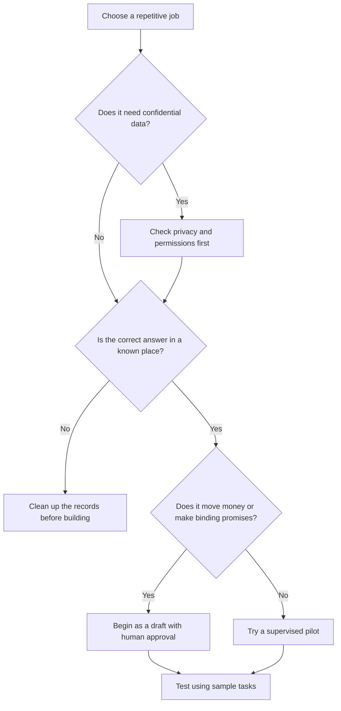

# Pick your first job

Business owners often begin with a long list: a receptionist, a salesperson, a finance clerk, a marketer, and a personal assistant. That is the wrong starting point. Choose **one repeating job with a measurable result**.

## A practical scoring method

For each candidate job, score these questions from 1 (poor) to 5 (good):

| Question | High score means |
|---|---|
| How often does the job happen? | Frequently enough to save meaningful time |
| Is the procedure consistent? | Staff usually follow the same steps |
| Are the required records available? | There is an identifiable source of truth |
| Is the risk manageable? | A wrong answer would be caught before serious harm |
| Can success be checked? | A person can tell whether the job finished correctly |

Add the scores. The total is only a conversation aid, **not** a universal formula. A job involving payments or confidential health information may still be unsuitable for automation even if its total is high.

## Four useful first projects

| Project | Why it is approachable | What remains with people |
|---|---|---|
| Answer questions from an approved FAQ | Limited source material and easy review | Unusual or sensitive questions |
| Sort an incoming shared inbox | Clear categories and destination teams | Important outgoing replies |
| Read invoice fields into a review sheet | Defined fields and a visible checking step | Payment authorization |
| Prepare a daily task summary | Read-only access can be enough | Management decisions |

## A first-job decision diagram

## A simple commitment

Finish this sentence before opening a software account:

> "For the next four weeks, I want to reduce the time spent on ______ by preparing ______ using information from ______, while ______ approves important actions."

Keep the sentence visible during the trial. New ideas can wait until the first job works.

**Next:** [A 30-minute exercise](03-thirty-minute-exercise.md).

## How to choose between two tempting projects

Suppose a retailer wants both a telephone receptionist and an automatic invoice-payments employee. The receptionist sounds harder because it uses voice, but it can begin by answering opening hours, collecting messages and transferring complex requests. The payment process might be easier to demonstrate, yet a mistake can move real money. Start with **operational consequence**, not apparent technical difficulty.

Score each candidate against the quality of its current records, frequency, value of time saved, clarity of the result, ease of reversing errors and amount of human supervision available. If your data is incomplete, spend the first phase cleaning it rather than installing a more powerful model.

### Comparison example

| Candidate | Repeat frequency | Trustworthy source | Reversible error? | Suitable first scope |
|---|---|---|---|---|
| Routine appointment questions | Daily | Live calendar | Usually | Read availability and draft confirmation |
| Supplier bank-account changes | Rare | Often disputed | Potentially difficult | No automated changes |
| Incoming receipt categorization | Daily | Expense policy | Yes, before approval | Prepare draft classifications |
| Public marketing captions | Weekly | Brand guide | Yes, before publication | Draft and review |

Choose one project with visible success. If staff say the workflow now creates more correction work than it saves, that is important evidence—not resistance to technology.

[Full platform selection workshop](../04-no-code/13-platform-decision-workshop.md)
