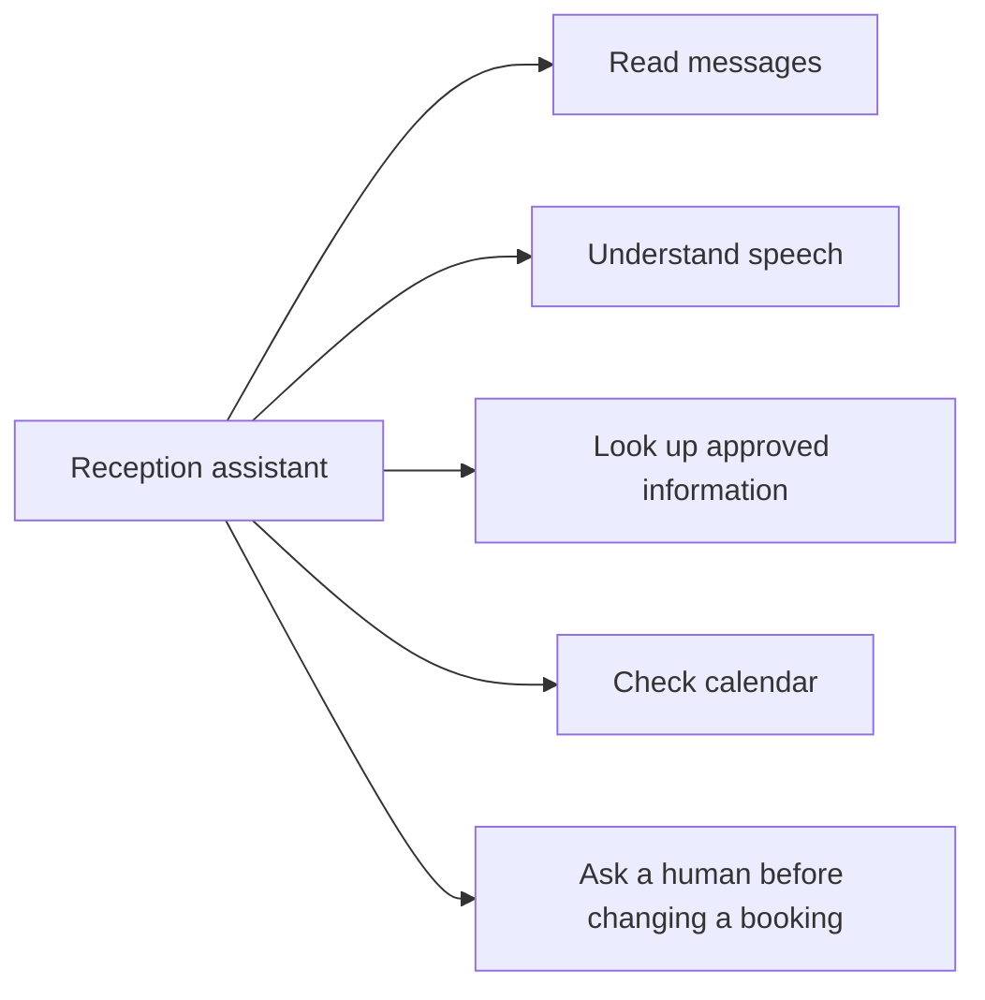

# What a digital employee actually is

The word *employee* is useful only as an analogy. A software assistant is not a person, does not hold professional accountability, and cannot independently accept legal responsibility for a business decision.

A practical digital employee consists of six parts:

1. **A job:** What result it is supposed to produce.
2. **Instructions:** The procedure, limits, and response style.
3. **Knowledge:** Company facts it may consult.
4. **Capabilities:** What kinds of material it can understand or produce.
5. **Connections:** Which business systems it can read or change.
6. **Oversight:** How its work is checked and when it stops for a person.

## One employee, several tools

A receptionist might read incoming email, understand a voice note through transcription, consult a booking calendar, and prepare a reply. These do **not** need to be four separate employees. They are four capabilities available to one job.

## Where the boundaries should be

A receptionist can usually answer opening-hours questions. It may be able to suggest an appointment time after checking real availability. It should not claim to have booked the appointment until the calendar system confirms it. It should not disclose another customer's details. It should not override staff-only pricing or cancellation rules.

## When more than one employee helps

Separate roles when the responsibilities, records, or permissions are materially different.

- An **intake assistant** sorts requests.
- A **sales assistant** prepares quotes using approved pricing.
- A **finance assistant** checks invoice data against records.
- A **reviewer** checks outputs and calls attention to exceptions.

Avoid separating tasks merely to give each one an impressive title. Every extra handoff creates delay and another possibility for misunderstanding.

## Five levels of independence

| Level | What happens | Example |
|---|---|---|
| Draft | Suggests something for staff to use | Writes an answer, but sends nothing |
| Read-only | Consults company systems | Looks up an order's status |
| Supervised action | Prepares an action and waits | Creates a quotation for approval |
| Limited routine action | Acts within verified boundaries | Tags an email or opens an internal task |
| Coordinated workflow | Several specialists do connected work | Inquiry → lookup → review → approved reply → record |

These are descriptive levels, not formal certifications. More independence is not always better.

## A useful test

Ask: "If this system stopped halfway through a request, could an employee see what it had done and safely continue?" If the answer is no, improve the records and handoffs before increasing autonomy.

## What an employee is not

A named assistant is not necessarily a worker with ongoing responsibility. It may be a one-off conversation, a reusable instruction, a workflow that runs when an event occurs, or a service that can carry out connected actions. Ask whether work persists after the conversation closes, whether another person can see the task, and whether completion can be verified in the relevant system.

For example, “Your customer reply is ready” may mean only that text was drafted. “Your reply was sent” should mean the authorized email or messaging service returned a send result. “Your meeting is booked” should mean the event exists in the live calendar.

### Independence should be graduated

Start with a reading and drafting role. Add restricted tool access once the records are reliable. Introduce reversible internal writes, such as creating a support task, after testing. Reserve sensitive external actions for named human authorization. Greater independence should follow evidence of safe performance, never just a vendor's description.

### A role card in ordinary English

> **Job:** Organize incoming service inquiries. **May read:** The approved service guide. **May do:** Create an internal draft and record a task. **May not do:** Quote an unapproved price, delete records or send a customer message. **When uncertain:** Ask for one missing fact or route to the service manager. **Proof:** The task appears in the register with the source and reviewer.

[Explore 30 practical roles](../08-deep-dives/13-roles-library.md)
