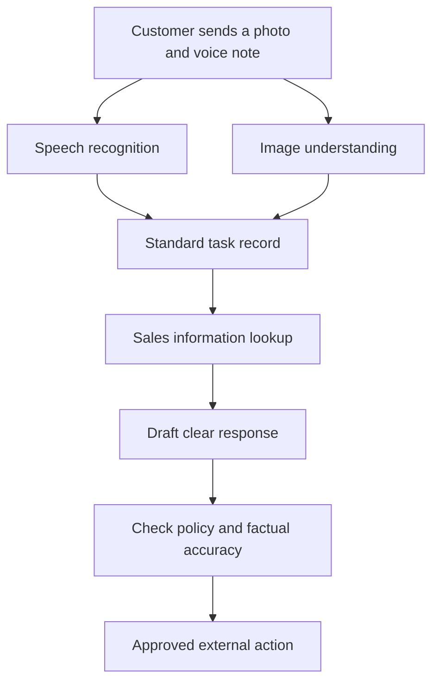

# Capabilities first; departments second

A team is easier to design if you list the abilities required, then assign them to jobs. Otherwise you may buy separate tools for jobs that actually need the same underlying skill.

## Twelve practical capabilities

| Ability | Plain-English meaning | Common use |
|---|---|---|
| Reading and writing | Understand instructions and prepare text | Email, proposals, FAQ replies |
| Reasoning | Compare conditions and plan steps | Choosing the right procedure |
| Research | Find and compare information with sources | Supplier or competitor review |
| Speech-to-text | Turn recorded speech into words | Voice notes, meeting transcripts |
| Text-to-speech | Read a response out loud | Telephone reception |
| Live conversation | Listen and respond during a call | Booking inquiries |
| Seeing images | Describe objects and text in pictures | Product photos, damage reports |
| Document reading | Extract fields from structured or scanned files | Invoices, forms, contracts |
| Spreadsheet work | Organize and interpret numbers | Monthly reports |
| Image creation | Produce a new illustration or design draft | Marketing concepts |
| Video work | Interpret or create clips, depending on service | Training and marketing |
| Connected actions | Use an authorized business app | Create tasks or update records |

**Important:** "Can look at a picture" does not mean "can certify a safety inspection." "Can read an invoice" does not mean "can authorize payment." Each job needs an acceptable use policy.

## A department map

| Area of business | Typical assistant | Required abilities | Typical source of truth |
|---|---|---|---|
| Front desk | Reception | Language, calendar, voice | Opening hours, booking system |
| Sales | Quote preparer | Reasoning, records, writing | Product catalog, pricing rules |
| Support | Case handler | Language, images, task tracking | Policies, orders, support history |
| Finance | Invoice clerk | Document reading, matching, math | Purchase orders, accounting |
| Operations | Dispatch clerk | Tracking, rules, records | Inventory, delivery platform |
| Marketing | Content editor | Research, writing, design | Brand guidelines, product facts |
| Management | Reporting assistant | Retrieval, comparison, summaries | Approved dashboard and reports |
| People operations | Policy assistant | Document search, careful wording | Current staff handbook |

## A worked example: a bakery with a wholesale business

A café asks for a quote for 250 pastries. One assistant can identify the product and quantity; another can consult the wholesale price list and stock; the quote preparer drafts the offer; a manager checks discounts and delivery promises. The bakery does not need a separate model for each employee: several roles can use the same writing and reasoning service, with different tools and instructions.

## Design for differences in authority

The marketing team may read the catalog but not change its prices. The sales team may prepare a discount request but not approve its own exception. A finance clerk may enter invoice fields but not release money. These separations should be enforced in connected applications, not merely written in a prompt.

See [roles and instructions](../06-management/01-roles-and-rules.md) and [the permission register](../07-templates/04-permission-register.md).

## A department is not a model

A finance department may need document reading, spreadsheet calculations, access to purchase orders and an approval system. A marketing department may need web research, copywriting, image creation and publishing permissions. The same general language model may contribute to both, but the tools and business rules are different. That is why capabilities should be shared while departmental permissions stay separate.

### Capability map for a common task

Do not confuse specialist *creation* tools with specialist *understanding* tools. A platform that generates a good promotional image may not reliably identify an actual appliance model from a blurry label. A tool that produces natural synthetic speech may not understand an accented phone call. Select capabilities based on the actual work.

### A small-business team design

A modest business might use a single intake assistant, two specialists (service and operations), and a reviewer. The owner remains responsible for approvals. A larger business may split duties because more people, records and consequences are involved. Both arrangements can be reasonable; the division should follow work boundaries.

[See the large multimodal map](../10-diagram-atlas/04-multimodal-work.md)
