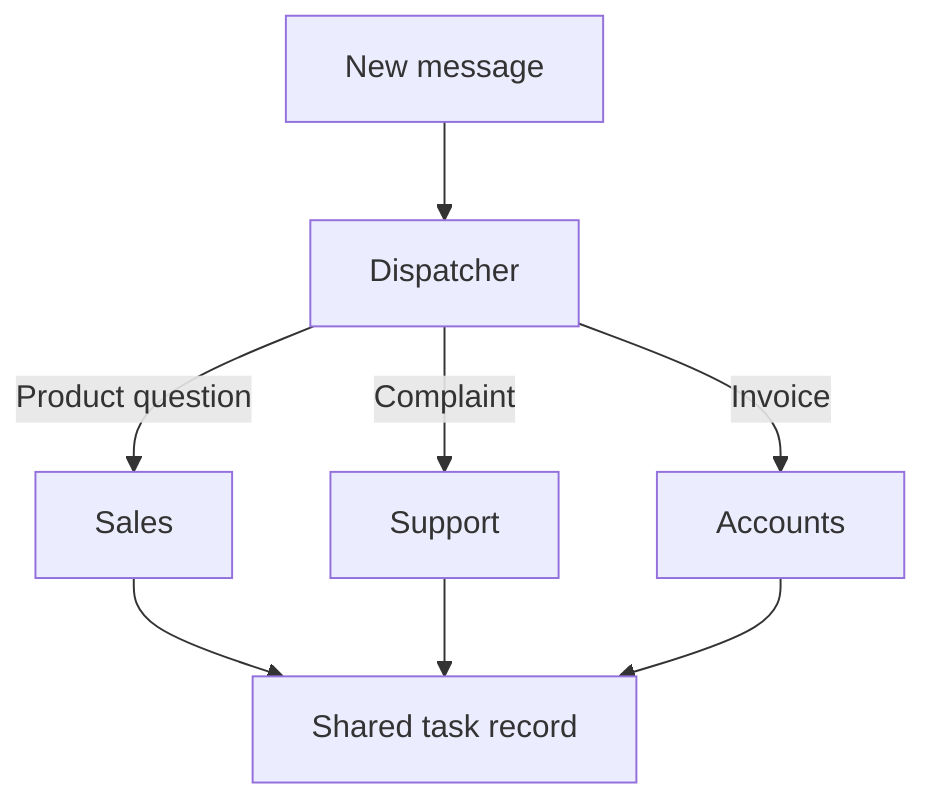
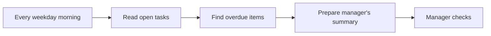

# Coordination and handoffs: how work moves between specialists

A multi-person office succeeds because people know which desk owns which task. A digital workforce needs the same clarity.

## The three common arrangements

**An assembly line.** Each step has a fixed place. Good for invoices and content approval.

**A dispatcher.** One coordinator chooses the appropriate specialist. Good for a mixed inbox.

**A scheduled routine.** The work begins at a regular time or when a particular event occurs. Good for daily summaries and monthly reporting.

## A handoff note should answer six questions

1. Which job is this? Use a task number.
2. Who or what started it?
3. Which facts have already been checked, and where?
4. What has been done?
5. What remains to be decided?
6. Who owns the next step?

Poor handoff: "Customer wants a quote, please assist."

Good handoff: "Task Q-104. Customer asks for 20 units of Product B by Friday. Product identity was confirmed from catalog item B22. Approved list price is 40 per unit. Stock not yet checked. Sales may draft; Operations must verify delivery date; manager approval needed for any discount."

## A job cannot disappear silently

Every task should have a visible status: **new, in progress, waiting for information, waiting for approval, completed, or needs human help**. Decide who receives an alert when a task is stuck.

## Prevent loops and duplicates

A sales assistant should not repeatedly ask Operations for the same stock check. A booking action should not create three appointments after a timeout. Practical safeguards include a unique job ID, recording each confirmed action, and checking the existing record before retrying.

More agents do not automatically improve a result. Start with a predictable sequence. Introduce flexible handoffs only when a fixed sequence cannot reasonably handle the work.

## A handoff that prevents a customer from repeating everything

An inquiry comes into reception: a delivery is late and the buyer is upset. Reception checks the order, notices a carrier discrepancy and passes the case to dispatch. If the handoff only says “Customer angry; please help,” dispatch must repeat the investigation. A useful handoff includes the task ID, order reference, verified dispatch status, carrier result, customer's stated issue, items still unclear and the person responsible for the next update.

### Handoff quality test

Give the handoff note to a colleague who did not see the original conversation. Ask them to identify what has been verified, what is disputed, what the next action is, and who owns it. If they cannot answer, the handoff is incomplete.

### Two hidden failure modes

**Loops:** Research sends work to Sales, Sales returns it to Research, and neither has a rule for stopping. Use a limited rework path and then escalate. **Duplicates:** A trigger retries after a temporary error, and two different specialists create the same customer record. Use unique task IDs and check for existing records before writes.

The task register should make "waiting for customer" and "waiting for approval" visible states, not forgotten conversations.

[Inspect the detailed task lifecycle](../10-diagram-atlas/03-task-life-and-handoffs.md)
