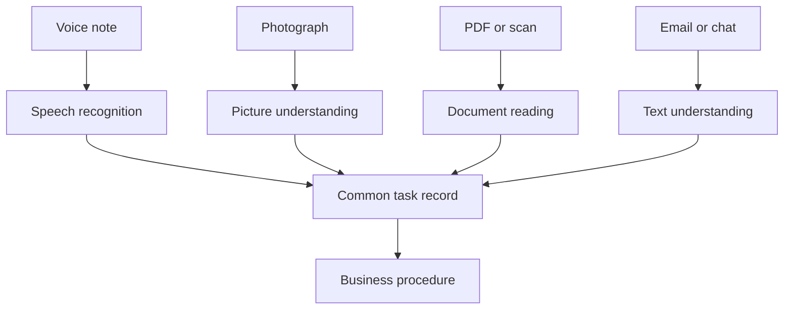

# Working with messages, voice, photographs, documents, and video

*Multimodal* simply means handling more than one form of information. A customer may type, speak, photograph, record, or attach a document. The business still needs a reliable way to identify the request and complete the right action.

## What happens at the front door

## Five examples

**Voice note from a customer:** A customer asks whether a particular service can be completed on Thursday. The recording is transcribed. The calendar and service-duration rules are checked. The draft reply is reviewed before any booking is confirmed.

**Photograph of a damaged package:** The system describes visible damage and opens a support case. It asks for the order ID and another photograph if necessary. It does not invent the cause of the damage.

**Scanned invoice:** The document reader extracts supplier, date, invoice number, total, and tax fields. Accounts compares these against the purchase order and flags differences. Nothing is paid automatically.

**Video from a site visit:** A staff member provides a short clip. A compatible service may describe visible conditions or help prepare a progress note. The site supervisor signs off on any safety or construction conclusion.

**Multilingual inquiry:** A guest writes in another language. The assistant drafts a translation and response using approved information. Technical or legally important wording is checked by a qualified person.

## Failure cases people miss

- A low-quality photograph may show two similar products.
- Noise can distort names, numbers, or dates in a recording.
- OCR may confuse 8 and 3, or read a total from the wrong row.
- A generated picture can look convincing while inaccurately depicting a product.
- A video tool may create clips but be unable to interpret an uploaded video.

Use a separate review rule for each kind of input. For example, ask a person to confirm extracted bank details even when document extraction looks accurate.

See [specialist tools](../02-models/04-specialist-models.md).

## How to handle a message containing several kinds of evidence

A buyer sends a voice note, a blurred photograph and a PDF receipt. The voice note is evidence of what the buyer says they want; the photograph may help identify the product; the receipt may support a purchase claim. None of those sources by itself proves present stock or successful settlement. The system should record the differences and look up the current product and payment records before making commitments.

### Practical media limits

| Input | What to preserve | What to confirm |
|---|---|---|
| Audio | Original meaning and uncertain words | Names, dates, numbers and consent |
| Photo | Visible content and image reference | Exact identity, date and context |
| PDF | Source file, extracted fields, page references | Missing pages, totals and authenticity |
| Video | Original media and time references | Whether interpretation is supported and complete |

It is usually wiser to introduce one new type of input at a time. Adding phone calls, photographs, documents and video in the first week creates too many failure paths to understand.

[Practice with the multimedia test set](../11-workbooks/08-voice-photo-document-tests.md)
