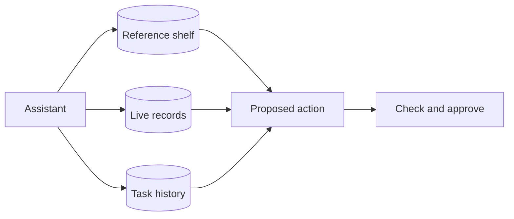

# Company knowledge and memory

A model can be very capable and still know nothing about today's stock, your current cancellation policy, or which supplier was paid yesterday. Knowledge must come from verified records.

## Three kinds of memory

**Reference shelf:** Manuals, policies, product descriptions, and staff guides. These answer "What does the company say should happen?"

**Live records:** Inventory, bookings, invoices, orders, customer cases. These answer "What is happening now?"

**Task history:** What has already been checked, approved, sent, or completed for this particular job. This answers "What happened next?"

## Example: which price is correct?

A sales brochure from last year says a service costs 500. The current approved price list says 575. The assistant must use the designated live pricing source, not whichever document it found first. If the sources conflict, it should pause and ask a human to resolve the issue.

## Give every source an owner

For each folder or table, note:

| Item | Example answer |
|---|---|
| Who maintains it? | Sales manager |
| How often is it updated? | When a new price is approved |
| Who may read it? | Sales and support |
| Who may change it? | Authorized pricing staff |
| What happens if it is outdated? | Do not quote; ask manager |

## Don't confuse chat history with a business record

Some products remember part of a conversation; others start each run using only configured information. Neither is a replacement for your CRM, order system, or task register. If the business needs proof that a message was sent, record the application's confirmation.

## Clean source material wins

Before uploading a large folder, remove duplicate versions, obsolete policies, inconsistent filenames, and private information the assistant does not need. A smaller, maintained collection is often more reliable than a huge, messy one.

## A conflict-resolution rule matters more than a large document library

Consider a service business where the website lists one price, a spreadsheet another and an old email mentions a discount. A general language model cannot know which is binding without business rules. The company must define the source of truth: perhaps approved price table for new quotations, signed contracts for existing clients, and manual review for disputed discounts.

### Source register example

| Source | Used for | Owner | When to review |
|---|---|---|---|
| Product list | General descriptions | Product manager | Product change |
| Live inventory | Actual availability | Warehouse | Every inquiry |
| Return policy | Eligibility and procedure | Service manager | Policy revision |
| Customer record | Specific order history | CRM owner | On authorized update |

A chat transcript is a history of an interaction; it should not silently become the official customer address. If the customer corrects an address, an authorized workflow should update the customer system and leave the change auditable.

[Full knowledge workshop](../08-deep-dives/06-business-knowledge-and-memory-workshop.md)
