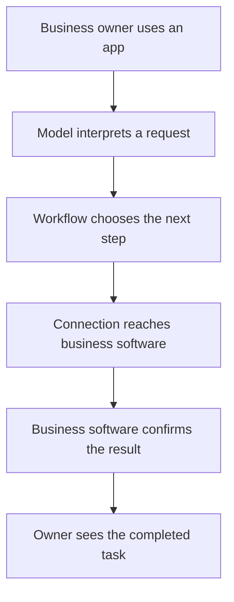

# Models, apps, workflows, and connections are different things

A restaurant owner might say, "I want ChatGPT to answer my calls, check bookings, and add appointments." That sentence combines four different tools. Understanding the difference can prevent an expensive purchase.

## Think of a model as a trained specialist's ability

The **model** is the part that interprets language, pictures, or other input and produces an output. Examples include models in the GPT, Claude, Gemini, Llama, and Mistral families. Some specialize in reasoning; some are optimized for speed; others are built for speech, pictures, or documents.

The **app** is the place where a person uses the model, such as ChatGPT or Claude. An app may add files, search, integrations, or a business workspace. A model name and an app name are not interchangeable.

The **workflow** is the sequence that starts with a business event and ends with a recorded outcome: a new email arrives, a tool checks the customer's order, a reply is drafted, a manager approves, and the record is updated.

The **connection** allows the assistant or workflow to use another business system. It might be a built-in app integration, an automation connector, or an MCP connection.

## Example: sending a quotation

| Piece | Example responsibility |
|---|---|
| App | Owner opens a chat or workflow builder |
| Model | Understands the customer's request and drafts the text |
| Company data | Provides current approved prices and stock |
| Connection | Reads the pricing table or CRM |
| Workflow | Checks fields, requests approval, records the reply |
| Human | Approves exceptions and large discounts |

Without an authorized email action, a model can draft the quote but **cannot claim to have sent it**.

## Three selection questions

1. Do I need a better answer, or do I need a business record to change?
2. Is the information text, speech, pictures, documents, or several of these?
3. Does this require one assistant or a defined sequence of work?

Those questions determine whether to change the model, add a specialist service, or improve the workflow.

## The four bills behind one apparently simple task

Imagine a telephone receptionist that listens, checks a calendar and speaks a confirmation. The business may pay for the phone connection, speech processing, a language model, and an automation or scheduling platform. A single chat subscription does not necessarily include all four. Conversely, a visual workflow platform may include some model usage while charging separately for specialist media.

### A useful selection order

Start with the **input**, **required action**, **source of truth** and **degree of risk**. Then choose the service that can safely handle them. For a scanned invoice, document extraction plus finance review may be more important than a high-reasoning text model. For appointment booking, live calendar access and a verified event receipt matter more than elegant conversation.

### Procurement confusion to avoid

The model provider, chat application and connected tool may have different privacy policies, regions, limits and billing arrangements. Write down all services that see the customer's information. Ask which one owns the business record at the end of the workflow.

[Choose the right capability with decision trees](../08-deep-dives/04-model-selection-decision-trees.md)
