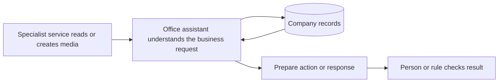

# Specialist services: listening, seeing, reading, drawing, and video

A general conversation model can do many things, but a complete business workflow may need services designed for a particular kind of input or output.

## Listening to customers

**Speech recognition** turns speech into text. Use it for voice notes, meetings, and recorded calls, with appropriate consent. [OpenAI transcription](https://developers.openai.com/api/docs/guides/speech-to-text) and [Mistral documentation](https://docs.mistral.ai/) provide examples of speech services.

**Speech generation** turns a written response into spoken audio. Use it for announcements or spoken assistants.

**Live voice conversation** combines listening, turn-taking, generating a response, and often telephone integration. Products such as [Voiceflow](https://www.voiceflow.com/) and [ElevenLabs ElevenAgents](https://elevenlabs.io/docs/eleven-agents/overview) provide visual configuration of customer-facing voice experiences. Check language quality, transfer to staff, telephone costs, and whether the service can confirm appointments in your actual calendar.

**Example:** A guest phones a hotel asking whether breakfast is included. The assistant checks the approved room policy. If the reservation type is unclear, it asks for the booking reference or transfers to reception.

## Understanding photos and scans

A **vision model** can describe a scene, read visible text, or compare pictured items. It can help support staff triage damage photos and identify likely product categories. It should not be trusted as a medical diagnosis, a legally binding inspection, or proof of delivery.

An **OCR or document extraction service** focuses on pulling text and fields from scans. [Microsoft AI Builder](https://learn.microsoft.com/en-us/ai-builder/use-in-flow-overview) offers document processing in Power Automate. The difference is useful: a vision model can discuss what a picture shows, while a document tool may be better for producing a table with invoice number, date and amount.

## Making pictures

Image-generation services create new visual assets. Use them for early campaign concepts, illustration drafts and layout ideas. Compare the result with actual products, brand rules and commercial-use terms. A generated picture is not proof that a physical product looks that way.

[Canva](https://www.canva.com/magic/) offers accessible design workflows. The final artwork should be reviewed before publication.

## Working with video

Two distinct jobs get called "video AI":

1. **Understanding a supplied clip:** Describing or summarizing visual events, where supported.
2. **Creating a clip:** Making new video from text or images; [Runway](https://runwayml.com/) is an example of a creative platform.

A tool that makes attractive video advertisements may not understand an uploaded site-inspection clip. Verify the exact function before buying.

## Searching large document collections

For policy and company-document questions, the system should find the relevant passage in approved material, show the source, and answer only within its authority. Some products call this *retrieval* or *RAG*. The everyday version is simple: **look up the relevant page before answering**.

A model that produces fluent answers without consulting the latest policy is not reliable for policy questions.

## A useful two-part design

Choose specialist services only when ordinary text handling is insufficient. Each added service adds a bill, a data-sharing decision, and another point where a workflow can fail.

## Matching specialist tools to a complete task

**Speech recognition:** Test names, numbers and accented speech, not just fluent transcription. **Real-time voice:** Measure conversation delay, interruptions, fallback and live transfer. **Vision:** Ask for visible observations and uncertainty; do not assume a photograph proves identity or cause. **Document extraction:** Verify fields and totals against originals. **Image creation:** Check brand, product fidelity and rights. **Video production:** Check claims, footage rights, editing quality and limitations. **Search or embedding models:** Evaluate whether the right source was retrieved; a perfect answer over the wrong document remains wrong.

### Why specialist services can be paired

A damaged-product case can use speech-to-text for a voice note, vision for a photograph, a general model to draft a response, and the order system to verify the purchase. These capabilities can be provided by different products. Adding vendors also adds data transfers, bills and support dependencies, so the setup should remain as simple as practical.

### Document extraction before accounting

An extractor can read supplier name, invoice number, currency, date, quantities and totals. Finance still needs duplicate checks, purchase-order matching, approval and payment separation. Do not use a successful OCR demonstration as proof of a ready-to-pay workflow.

[Multimodal masterclass](../08-deep-dives/07-multimodal-workshop.md)
