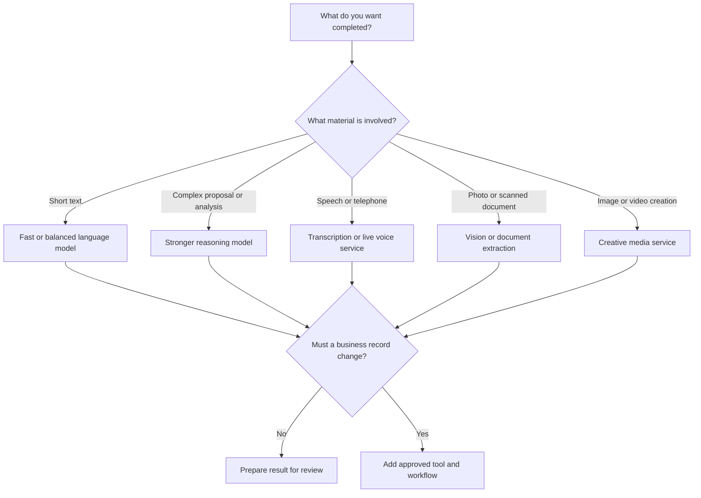

# Choosing the right model for a real business task

A business owner does not need to follow every new model announcement. The choice starts with the work. Do you need quick classification, careful reasoning, a picture interpreted, a voice call handled, a document searched, or a record updated?

## Start with the outcome, then choose the capability

Do not ask an expensive reasoning model to perform arithmetic that a spreadsheet formula already handles accurately. Do not use image generation to verify a real product photograph. Do not treat a search answer as a payment confirmation.

## A deeper look at the model families

### GPT models — a broad office starting point

For a business trying its first writing, analysis, document discussion or mixed-media task, GPT models through ChatGPT or supported integrations are a reasonable candidate to test. Availability of particular reasoning, speech, image or app features depends on the selected product and plan. Use the [official model guide](https://learn.chatgpt.com/docs/models) rather than treating a model from an online review as available to everyone.

**Try:** Draft a customer complaint response based on the correct policy. **Check:** Does the model avoid promising a refund that policy does not allow?

### Claude models — a candidate for complex reading and drafting

The Claude family includes different speed and capability tiers, such as Opus, Sonnet and Haiku, with additional offerings described in the provider's catalog. Test these for long proposals, contract summaries, detailed writing or document comparisons. A strong summary still requires staff to check the original document, especially for binding terms. [Claude models](https://platform.claude.com/docs/en/models/overview).

**Try:** Compare two supplier offers and identify differences in quantity, payment terms and deadlines. **Check:** Are exceptions described accurately, and does it cite the correct passage?

### Gemini models — a candidate for mixed information and Google-centered work

Gemini's model family includes variants with different speed and multimodal capabilities. Google products may also provide strong integration with Workspace tools, but a model's abilities and a Workspace automation product are different layers. [Google model cards](https://deepmind.google/models/model-cards/).

**Try:** Summarize a supplied meeting note and photo from a field visit. **Check:** Does the result distinguish visible facts from interpretations?

### Cohere — candidate for organizational search and multilingual knowledge

Cohere documents models suited to enterprise retrieval, multilingual work, and visual document understanding. These are worth investigating when the hardest job is finding and accurately using information spread through an organization's records. [Cohere catalog](https://docs.cohere.com/docs/models).

**Try:** Answer a detailed policy question using approved documents. **Check:** Is the answer linked to the correct version of the policy?

### Mistral — hosted and open-weight options

Mistral documents general, vision, speech and document-related model choices. Some are accessible through hosted services; others may be selected by organizations with more technical hosting needs. For a no-code buyer, the real question is which business app exposes the model safely. [Mistral docs](https://docs.mistral.ai/models).

**Try:** Transcribe a sample audio note or classify a document using an available product. **Check:** Numbers, names and language accuracy.

### Llama — a family for more control through suitable providers

Meta's Llama models are distributed with model weights under specific license terms. Running and maintaining them yourself is usually beyond a no-code pilot. A hosted application can make the experience accessible, but then that host's security, support and pricing matter. [Meta Llama](https://github.com/meta-llama/llama-models).

**Try:** If a hosted product is already available, compare a routine office task against your primary model. **Check:** Quality, privacy terms and actual running cost.

### DeepSeek, Qwen and Grok — alternatives to evaluate for a specific reason

These families also offer general reasoning or multimodal capabilities through their supported services. Their features and versions change. Consider them when they are available in your chosen platform and meet your business's needs rather than assuming a model name alone establishes superiority. [DeepSeek](https://api-docs.deepseek.com/quick_start/pricing/) · [Qwen/Alibaba](https://www.alibabacloud.com/help/en/model-studio/models) · [Grok/xAI](https://docs.x.ai/developers/models).

**Try:** Run the same five ordinary tasks and two difficult cases used for your existing model. **Check:** Exact outcomes, integration support and data-handling terms.

## Test the role, not just a single response

Consider an enquiry that needs a product price and appointment availability. A model may explain the request brilliantly while having no access to the price list or calendar. Another model with a well-designed connection may complete the business process more reliably. Give both the same information and permitted tools before comparing outcomes.

## An example allocation for a small business

| Task | Initial choice | Why not a more complex choice? |
|---|---|---|
| Classify 200 inbox messages | Fast general model | Short categories; detailed reasoning may be wasteful |
| Prepare a significant proposal | Balanced or strong reasoning model | More careful comparison is worth testing |
| Read 100 scanned invoices | Document-processing service | Structured fields and confidence checks matter |
| Convert voice notes to text | Transcription service | Listening is a specialized task |
| Respond to routine customer FAQ | General model with approved retrieval | Knowledge quality matters more than model prestige |
| Show today's late orders | Direct report or workflow, with optional written summary | A database query is the source of truth |
| Make a campaign graphic | Image/design tool | Not the job of a text-only model |

## How to avoid changing models every month

Keep a small fixed test set. If a new model offers an important feature, run the tests. Change only when the improvement is worth the migration and operational risk. A stable business workflow is more valuable than constantly chasing product announcements.

## A model allocation should be treated as a starting hypothesis

Imagine the same business has three tasks. A quick model classifies 300 incoming messages per day. A balanced model drafts responses to the 70 messages requiring actual explanation. A stronger model handles five complicated supplier comparisons per month. This arrangement might reduce cost, but only if the classification and handoff are reliable. It should not be installed as a rigid rule simply because the model tiers have different names.

### The hidden cost of constant switching

A multi-model system can create different writing styles, inconsistent interpretations, separate retention terms and additional tracing work. If two models disagree on the same contract clause, the business still needs a human source-based resolution. A second model is not automatically an independent verifier if both depend on incomplete or incorrect input.

Keep the test cases, approved instructions and business records separate from whichever provider runs the language step. This preserves the ability to change providers without losing the actual process.

[Model switching and portability](../08-deep-dives/16-model-change-and-portability.md)
