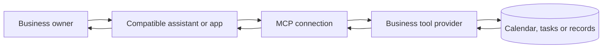

# MCP explained without technical jargon

**MCP stands for Model Context Protocol.** It is a shared set of rules that allows compatible assistants to discover and use tools or information supplied by another service. The official specification describes three main things a connection may offer: **tools, resources, and prompts**. [MCP specification](https://modelcontextprotocol.io/specification/2026-07-28) · [MCP server concepts](https://github.com/modelcontextprotocol/modelcontextprotocol/blob/main/docs/docs/2026-07-28/learn/server-concepts.mdx).

## The office analogy: a staffed service counter

Picture a manager sitting at a desk. The manager can write a request, but cannot walk into every department's locked filing cabinets. Each department has a service counter. At the counter, the manager is told which services are available, what information may be read, and which actions require permission.

MCP provides a common way for those service counters to describe themselves and accept requests. It does **not** grant permission by itself.

## The four parts that matter to an owner

| Term | Everyday meaning | Example |
|---|---|---|
| **Host / client** | The app where you ask for help and choose connections | A compatible assistant or no-code platform |
| **MCP server** | The service counter offering tools or information | A provider's supported connection to a calendar |
| **Tool** | A particular action or lookup the connection offers | Search appointments, create task, find invoice |
| **Permission** | What the owner authorizes that connection to do | Read calendar, but do not delete events |

The name **server** sounds complicated. For a no-code owner, it may simply be a connection supplied by a trusted product. A custom server usually requires technical setup; you do not need to build one to understand or use an existing one.

## Tools, resources, and prompts

**Tools** are actions or searches: "Find the appointment" or "Create a follow-up task." Some tools change records, while others only read.

**Resources** are information made available to the assistant, such as a policy document or catalog description. In the protocol, these are a defined kind of source; the term does not mean unlimited access to all company files.

**Prompts** are prepared instruction templates that a server may offer. A connection does not have to provide all three kinds.

## A story: the owner asks for tomorrow's schedule

1. The owner asks: "What is on my work calendar tomorrow?"
2. The app discovers that an authorized calendar lookup is available.
3. It uses that lookup, if the connection and permissions permit.
4. The calendar system returns the events it can access.
5. The assistant summarizes them and, where possible, points to the original records.

**What did MCP do?** It helped the app call a compatible service using a standard approach.

**What did MCP not do?** It did not invent meetings, provide the model's reasoning ability, guarantee data accuracy, or decide whether appointments should be deleted.

## Five common misunderstandings

1. **MCP is not a model.** It connects models or apps to external capabilities.
2. **MCP is not the same as a workflow.** It may supply a tool; a workflow decides when and how to use it.
3. **MCP does not guarantee no-code setup.** Some servers require hosting or administrator support.
4. **MCP does not automatically make a service trustworthy.** A malicious or over-permissioned connection is still dangerous.
5. **MCP does not ensure an action succeeded.** Check the result in the actual business system.

## When MCP is useful

Use MCP when a compatible assistant or platform needs a capability available from a trusted server and that connection is easier to govern or reuse than building separate custom integrations.

For a simple fixed workflow, a built-in connector or ordinary automation step may be just as good—or easier.

**Next:** [Ten everyday examples](02-mcp-examples.md) and [how to connect safely](03-no-code-connection-walkthrough.md).

## A deeper example: one tool, two different permissions

A calendar connection might offer `list events` and `create event` as separate operations. A receptionist asked to show tomorrow's free slots only needs reading permission. Creating a confirmed booking requires both a user decision and an appropriate write capability. Deleting a colleague's booking requires a different authority again. These are not merely polite differences in the model's instructions: the business system or connector must enforce the distinctions.

### Who manages the connection?

Some services offer ready-made connectors that a business owner can authorize through a sign-in screen. Custom remote MCP servers are more specialized: the business must know who hosts the server, what the URL belongs to and which tools it exposes. A provider can make the connection easy to use without making it risk-free. Always check whether user permissions remain personal or whether a shared account gives everyone broad access.

### One sentence to remember

**MCP standardizes a conversation between an assistant and tools; it does not confer authority to use those tools.** A model cannot read an accounting system that is not connected, and a valid connection should not grant access to records the user is not authorized to see.

[Read the full no-code MCP masterclass](../08-deep-dives/01-mcp-business-owner-masterclass.md)
