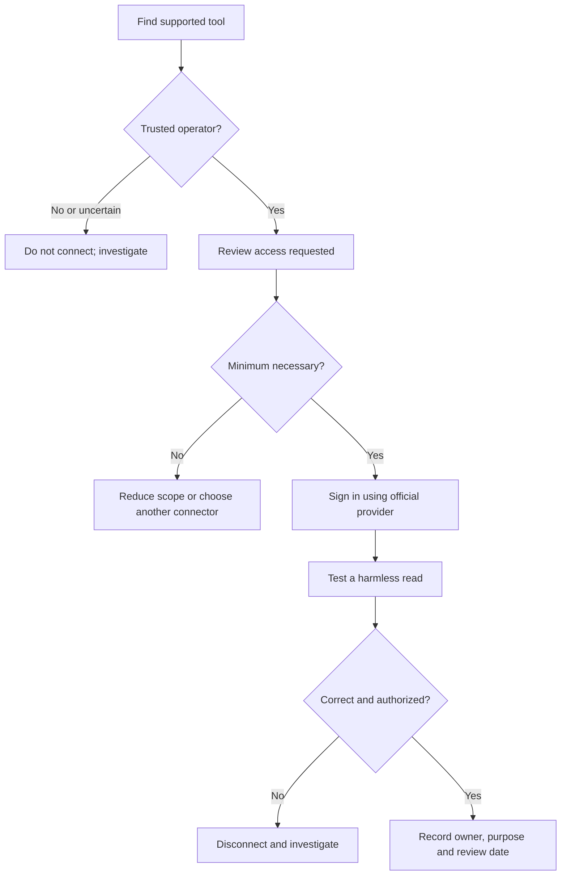

# Connect a business tool without writing software

This walkthrough uses a **read-only calendar or task lookup** as the first connection. The exact buttons change by product and account plan. Follow the vendor's current interface rather than an old video tutorial.

## Before you begin

- Choose an assistant or no-code platform that supports a connection to the service you actually use.
- Use a business account you are authorized to connect.
- Prefer a **provider-operated, verified, or organization-approved** connection.
- Check whether you are granting access to a single calendar or a whole account.
- Decide who will disconnect the service if a device, employee account, or vendor is compromised.

## The safe first connection

1. **Open the platform's connection settings.** Look for Apps, Connectors, Tools, Integrations, or MCP.
2. **Choose an existing supported connection.** Do not start by creating a custom server.
3. **Check who operates it.** A third-party server with a familiar name is not necessarily run by the familiar brand.
4. **Read the permission screen.** For the first test, a calendar-reading ability is enough. Decline broad write or delete access if unnecessary.
5. **Sign in through the provider's official flow.** Do not paste passwords into chat messages or Markdown notes.
6. **Confirm which tools are available.** If the list includes delete or update actions, make sure your platform can restrict them.
7. **Ask one harmless question.** For example: "Which meetings on my selected test calendar happen tomorrow?"
8. **Compare the result with the calendar itself.** Check event count, dates, time zone, and visibility.
9. **Try an error case.** Ask for a meeting that does not exist. It should say that no matching record was found.
10. **Write down the connection owner and review date.** Retest if permissions, plan, or product versions change.

## Where you may find MCP connections

- **Claude:** Anthropic documents ready-made connectors and adding approved custom remote MCP connectors. Check the account's plan, permissions and owner/admin controls. [Claude connectors guide](https://support.claude.com/en/articles/11176164-use-connectors-to-extend-claude-s-capabilities) · [Custom connection guide](https://support.claude.com/en/articles/11175166-get-started-with-custom-connectors-using-remote-mcp).
- **ChatGPT:** OpenAI documents supported apps and custom MCP arrangements. Availability and permission settings depend on product and workspace. For a business owner, begin with the available built-in apps before considering a custom MCP server. [OpenAI Help](https://help.openai.com/en/articles/12584461-connecting-custom-mcp-servers-in-chatgpt).
- **Microsoft Copilot Studio:** Microsoft documents adding tools from existing MCP servers to agents. Your organization may need administrator configuration. [Microsoft Learn](https://learn.microsoft.com/en-us/microsoft-copilot-studio/agent-extend-action-mcp).
- **Make:** Make offers MCP server and client features; visual scenarios can supply workflows to compatible assistants or use compatible external MCP tools. [Make MCP](https://www.make.com/mcp) · [MCP Client documentation](https://apps.make.com/c5ZhYquO55e90hoCJ0rzt).
- **Google Workspace:** Google documents Workspace MCP servers, but setup may involve a Google Cloud project and OAuth configuration. It should not be described as universally one-click or guaranteed no-code. [Google Workspace MCP guidance](https://developers.google.com/workspace/guides/configure-mcp-servers).

## A sensible second test: create an internal task

Only after the read test succeeds, connect a limited "Create task" action in a **test workspace**. Ask for a harmless task such as "Review office stationery order on Friday." Check whether the task actually appears and whether running the same request twice creates duplicates. Keep delete actions disabled.

## When to stop and ask for help

Pause if the setup asks you to host a server, open network ports, configure complex identity permissions, or paste long secret access tokens into unfamiliar sites. These may be legitimate technical steps, but they are beyond the simple no-code setup described here.

## A stronger acceptance test

After connecting a test calendar, ask for a real available slot and independently check the calendar. Then ask for an operation you intentionally did **not** authorize, such as deleting an event. A safe outcome is a genuine permission denial or absent tool, not only a text reply saying "I cannot" while the action remains accessible.

Next, deliberately break the connection—for example, revoke authorization or remove access to the test calendar. The assistant must report that the data cannot be verified. It should not continue using an earlier availability answer as if current. A business owner who only tests the successful path misses a major part of the operating responsibility.

### Ownership and offboarding

Write down which account authorized the connection, who can revoke it, and whether automations remain scheduled after disconnection. When an employee leaves, the business may need to reassign tasks and rotate credentials, not merely remove that person from the chat application. A shared service credential can be particularly risky if its administrator is unknown.

[Use the connection register](../11-workbooks/13-mcp-connection-register.md)
