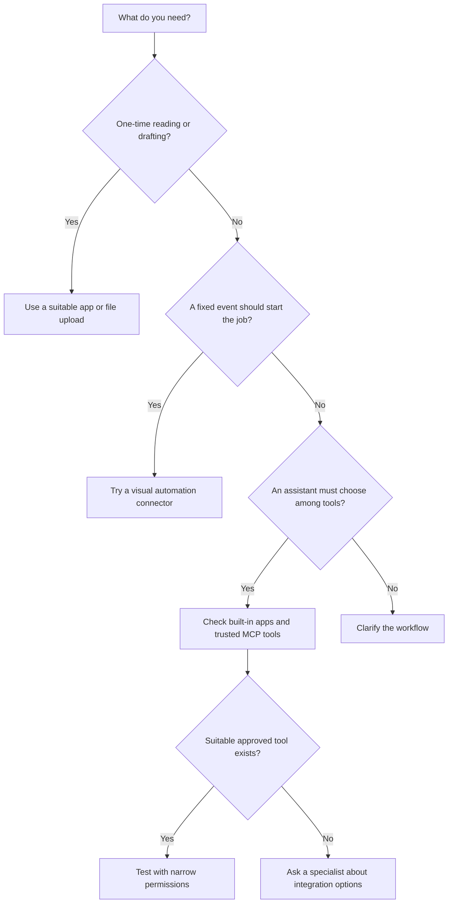

# MCP, built-in connections, APIs, and automation: which one do you need?

These terms often appear together in product descriptions, but they solve different problems.

| Option | What it means in everyday terms | Good use | Main caution |
|---|---|---|---|
| Built-in app connection | The platform already knows how to work with an app | Read Gmail or calendar through supported product menus | Check account and access scope |
| Visual automation connector | A no-code workflow step connects to an app | On new form submission, create a CRM record | Requires field mapping and failure handling |
| MCP connection | A compatible assistant can discover and call offered tools or sources | Ask an assistant to search tasks or trigger an approved workflow | Trust the server and verify permissions |
| API | The underlying structured interface software uses to communicate | Custom integration when no connector exists | Usually more technical to set up |
| File upload | You manually give the assistant a document | Summarize one proposal | It may become outdated immediately |

## One business problem, four possible routes

**Problem:** "Each new website inquiry should appear in our task tracker."

**Manual route:** Staff copy the inquiry into the tracker.

**Built-in connection:** An available product app may allow the assistant to create a task when asked.

**Visual workflow:** A form submission automatically triggers a Make or Zapier flow that creates the task. Often the simplest no-code choice for fixed event-based work.

**MCP:** A compatible assistant calls a task-creation tool exposed by a trusted MCP service. Useful when a person wants flexible language-based access to a tool, or when the same provider exposes a reusable set of actions.

For a predictable form submission, you may not need MCP at all.

## The distinction that saves money

An **MCP server can offer a tool** to create an appointment. It does not determine when the company should create appointments, whether a customer is eligible, or who may override a cancellation rule. Those are workflow and permission decisions.

Likewise, a powerful model does not necessarily need MCP. It may already have a supported app connection to the system you want.

## Decision tree

The correct starting point is the simplest approach that reliably completes the job.

## The operational cost of a second integration layer

An owner may be tempted to use an MCP server even when the current workflow platform already has a supported app module. That can produce two sets of credentials, two failure points and a harder support path. The better question is: which connection has the precise permission controls, audit evidence, vendor support and error handling this job requires?

For a fixed "new form → spreadsheet row" process, ordinary automation may be sufficient. For varied questions such as "find the three customers whose appointments moved after yesterday's email," an assistant with carefully scoped search tools could be more useful. For a high-value bank change, neither route should replace the organization's verified approval process.

### Decision questions

Does the workflow need to interpret an open-ended request? Does the application already have a supported connector? Can the owner inspect the exact operations? Can it be disabled immediately? Can it recover from an error without duplicating a transaction? An additional layer is justified only if it improves a real requirement.

[Full comparison with examples](../08-deep-dives/08-automation-vs-agent-vs-mcp.md)
