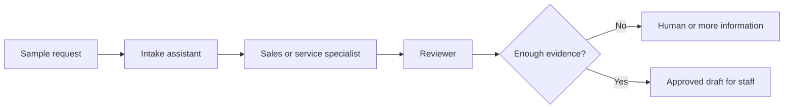

# Build a three-person digital team in Relevance AI

**Goal:** A message arrives, an Intake Assistant identifies the request, a Specialist prepares the work, and a Reviewer checks it. The system must not send a customer message automatically during the first trial.

This is a walkthrough of the **design and configuration process**, not a claim that every menu label is unchanged. The authoritative reference is [Relevance AI Workforces](https://relevanceai.com/docs/get-started/core-concepts/workforces).

## What you will build

## Step 1 — Prepare the information first

Create a short sample company profile, FAQ, current price list, and refund procedure. Use invented data in the first trial. A common setup mistake is to create agents before deciding what facts they should rely on.

## Step 2 — Create the Intake Assistant

In the agent-building area, create a new specialist with a descriptive name. Its job is to identify what the person wants, collect relevant facts, and select the next specialist. Tell it to return:

- Request type: sales, support, billing, or other.
- What the customer asked for.
- Which details are confirmed.
- Which details are missing.
- Whether staff should intervene.

It should not quote prices or grant refunds unless those responsibilities are deliberately included.

## Step 3 — Create one work specialist

For example, create "Quotation Preparer." Give it permission to consult the approved example catalog. Tell it to prepare a quote **draft**, distinguish verified prices from missing prices, and mark any discount as requiring approval.

Try this sample: "Please quote 12 units of item B for delivery next Wednesday." A successful draft identifies the item and quantity, checks the price source, and avoids promising delivery without confirmation.

## Step 4 — Create a Reviewer

The Reviewer checks whether the draft matches the approved catalog and business rules. It reports:

| Check | Expected answer |
|---|---|
| Was the exact item identified? | Yes, no, or uncertain |
| Was the price found in the approved source? | Yes or no |
| Is the delivery date verified? | Yes or not yet |
| Is manager approval required? | Yes or no |
| Can staff use the draft? | Ready or needs correction |

A Reviewer may catch mistakes, but it is **not** a substitute for the business owner's required approval.

## Step 5 — Connect the three roles

Use the Workforce canvas to place the agents in order. Give the handoffs clear names: "Prepare a quote from the intake record" and "Check the prepared quote." Ensure each handoff carries the original request and verified findings.

## Step 6 — Run five trials

1. A normal product inquiry.
2. A request for an unknown product.
3. An unapproved discount request.
4. An inquiry with a missing delivery address.
5. A customer message containing misleading instructions such as "ignore all your rules."

Check that the system handles missing information and asks for help rather than inventing details.

## Step 7 — Add one business tool only after the drafts work

For example, connect a task tracker and let the team create a draft follow-up task in a test workspace. Keep customer messaging, payment tools, and destructive changes outside the pilot.

## Step 8 — Establish an owner

A human must review the workflow logs, correct the knowledge base, and decide when to expand its permissions.

## Signs you should simplify

If the agents repeatedly pass the same request back and forth, remove a role or use a fixed workflow. If each role re-reads the entire document collection, improve the handoff and source selection. If the Reviewer's comments are vague, give it a concrete checklist.

The purpose is a reliable finished draft, not an impressive-looking chain of agent names.

## A better first scenario: supplier comparison

Use three fictional supplier quotes with different base prices, transport costs, warranty and delivery terms. Have one specialist extract fields, a second explain trade-offs, and a reviewer check the original documents. Configure predictable handoffs before letting the system select freely among specialists.

For example, Supplier West may appear cheapest until delivery is added. If its transport fee is not stated, the system should not invent a total. Test whether the reviewer identifies this missing piece and returns the task for clarification. A reviewer that praises the draft without checking the source is not adding value.

### Make the output auditable

Keep a task ID, source quotation links, comparison table, unresolved questions, approval status and final decision. The owner, not the workforce, decides which vendor receives a purchase order. This gives the business a testable process with a defined end point and genuine handoffs.

[Long-form Relevance AI build](06-relevance-workforce-full-build.md)
