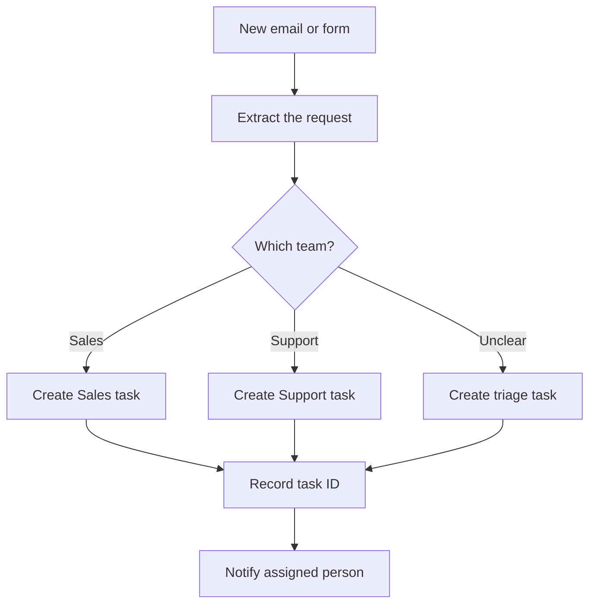

# Build an inbox-to-task workflow in Make

**Goal:** When a new inquiry arrives, create a task with its subject, source, priority, and proposed owner. A person reviews the task before the company sends a reply.

Make offers visual scenarios and AI-related modules. The exact available modules depend on the connected services and account. See [Make](https://www.make.com/) and [Make MCP](https://www.make.com/mcp).

## A visual outline

## Step 1 — Create a test inbox or form

Do not connect the owner's complete mailbox on day one. Use a dedicated test label, folder, or form with invented requests. Decide how incoming items should be identified to avoid processing them twice.

## Step 2 — Start a visual scenario

Select a supported trigger such as "new form response" or "new email in selected folder." Test that it retrieves the correct message and does not accidentally process old mail.

## Step 3 — Add interpretation

Add a suitable AI module or agent step to classify the request. Keep the output simple:

- `Sales`, `Support`, or `Unclear`.
- One-sentence summary.
- Customer reference if present.
- Missing information.
- Suggested priority.

These are **example field labels** for configuring a visual interface, not code you must write.

## Step 4 — Route the request

Use a router or conditions in Make to send each category to the proper branch. Always include an "Unclear" path so the workflow does not silently drop difficult messages.

## Step 5 — Create the task

Connect a supported task system, spreadsheet, or database. Map the fields from the incoming request to the new task. Include the original message reference so staff can verify the summary.

## Step 6 — Add a confirmation step

Read the result returned by the task system. A model saying "task created" is not proof; the task system should return a task ID or other confirmation. Save that ID in the run history if possible.

## Step 7 — Test failure cases

- The email has no subject.
- The customer writes in another language.
- Two messages discuss the same ticket.
- The task service is temporarily unavailable.
- The AI classification is uncertain.
- The same trigger is accidentally delivered twice.

Define what happens to each case. A failed job should enter a review queue instead of vanishing.

## Step 8 — Add customer replies later

First let staff approve drafts manually. When the workflow has a strong track record, consider allowing specific low-risk responses using exact approved templates and verified customer consent.

## How MCP may fit later

Make can expose selected scenarios to a compatible assistant through its MCP server, or connect a scenario to external MCP tools through supported client modules. This is useful for flexible requests like "Create a follow-up task for the customer we discussed," but is **not required** for the inbox-to-task automation itself. [Make MCP overview](https://www.make.com/mcp) · [Make MCP Client](https://apps.make.com/c5ZhYquO55e90hoCJ0rzt).

## Common mistake

Turning every straightforward step into an agent decision. If a form contains a clear email address, copy that field directly. Use a model only for the unclear parts such as interpreting the customer's intent.

## Where to put the judgment

A predictable workflow step should handle predictable operations. For example, when an email arrives, the email connector supplies the message ID. A filter can reject known notification emails. A model can classify the remaining message. A router can send `quote` requests to sales and `support` requests to service. A manager can approve an outgoing response before the send module executes. Not every step needs a model.

### Avoid duplicates and false completion

Use the incoming message ID to recognize repeated triggers. If the CRM create action times out, check whether the record exists before retrying. If an email is only drafted, leave the task as "awaiting approval" until the actual send returns a result. Log errors and keep a manual review path.

### Test the unhappy path

Disable the price source, create a duplicate inquiry, provide an invalid contact address and withhold approval. These cases reveal whether the process is robust or just visually impressive.

[Long-form Make build](07-make-full-build.md)
