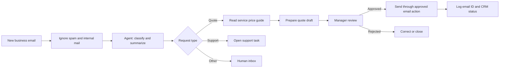

# Make: automate an inquiry from arrival to approved reply

This example is built around Make's visual scenario editor and its newer **Make AI Agent (New)** capability. The official guide identifies a **Run an agent** module inside a scenario. Product labels and availability may change, so consult the linked current help pages.

## What the business wants

An email arrives requesting a service quotation. The workflow saves the inquiry, asks an agent to classify it, retrieves approved service descriptions, drafts a response, and sends a manager a review request. A human decides whether it goes out.

## Stage one — create the scenario

Open Make and create a new scenario. Add a supported email trigger for the chosen mailbox. Before connecting the live inbox, use a test mailbox or a narrow label/folder. If the connector polls periodically, note the delay. Use a filter to exclude internal notifications and unrelated mail. Decide whether duplicate messages need to be suppressed using message IDs.

## Stage two — ask the agent to understand the inquiry

Add the **Make AI Agent (New) → Run an agent** module described in the official help. Select the supported model provider connection available on your account. Give the agent a short and bounded assignment: classify the message into `quote`, `support` or `other`; extract the stated service need, customer name, contact channel and unanswered questions; and prepare a brief summary.

Do not ask the agent to send or quote prices at this step. The input is untrusted email. In its own field, require it to return "information missing" rather than inventing service details.

## Stage three — route with ordinary rules

Add a visual router or equivalent conditional paths. A `quote` classification follows the quotation branch. `support` creates a support record or alert. `other` goes to an employee. This routing can be made deterministic once the classification is supplied. The separation helps trace failures: was the classification wrong, or did the routing rule fail?

## Stage four — retrieve approved information

Connect the approved price sheet or service catalog. The service name must match an actual record. A missing price should stop the quotation branch and create a manager task. Avoid downloading the whole customer database when only a single service price is required.

## Stage five — draft and approve

Prepare a draft containing the customer's request, verified service terms, relevant price or a request for details, and a disclaimer if delivery time cannot yet be confirmed. Route the draft to a manager or an approval step supported by your tooling. Do not rely on an instruction like "always ask first" if the sending action is already available to the agent.

## Stage six — verify the actual send

After approval, use the email connector's send action. Record the sent-message ID and update the task status. If sending times out, search for the message before retrying. Otherwise the customer may receive duplicates. Keep the internal log free of unnecessary personal details.

## Eight test messages

| Email | Expected branch |
|---|---|
| “Please quote website maintenance for one year” | Quote; likely needs service scope |
| “Our installed unit is leaking” | Support; urgent triage according to policy |
| “Can you send me your opening hours?” | Other or service FAQ, depending on design |
| “Please transfer funds to this new account” | Human and finance verification; no payment |
| Blank message with attachment | Ask for context or use a dedicated attachment workflow |
| Two identical copies of same message | One task, not two |
| Email claims to be from the owner | Verify identity and role outside the message content |
| Nonsensical text or unsupported language | Escalate, do not invent an answer |

## Common operational problems

**The trigger does not fire:** Check mailbox, label, schedule and connection permissions. **The agent returns a paragraph instead of a category:** Simplify the instructions and validate the returned field. **The price is wrong:** Check which record the workflow retrieved, not only the drafting step. **The scenario runs twice:** Inspect event IDs, replay behavior and retry design. **A reviewer never responds:** Add a timeout and human backup route.

**Official reading:** [Create your first Make AI agent](https://help.make.com/create-your-first-ai-agent), [Make AI Agents (New)](https://help.make.com/meet-the-new-make-ai-agents-app), [Make scenarios and errors](https://help.make.com/error-handling).
