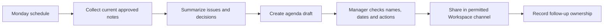

# Google Workspace Studio: an internal office workflow

Google Workspace Studio is intended for flows across Workspace tools such as Gmail, Drive and Chat, with access controlled by the organization. It can be a strong choice when employees already work in Google Workspace and the first goal is **office productivity**, rather than customer-facing telephone automation.

## Example: weekly meeting preparation

Every Monday, a manager needs a list of overdue tasks, decisions awaiting approval, and a draft agenda. The flow gathers approved inputs and prepares a summary for review.

### Before you begin

Ask the Workspace administrator whether Studio is enabled for your account and whether connected services are approved. The official admin guide directs users to `studio.workspace.google.com` and documents product restrictions such as flow step limits. Check those restrictions for your organization's edition and region.

### Design on paper first

Create a simple Drive folder of approved meeting notes, with consistent names and an owner. Decide what counts as overdue, which tasks may be mentioned, and who is authorized to read the summary. Do not collect personal notes, confidential HR material or unrelated files by default.

### Create the flow

In Studio, create a new flow from a described task or the supported visual steps. Choose a schedule trigger or an appropriate incoming event. Define the information to gather and the summarization step. Keep the first version in a private review channel or draft output rather than automatically broadcasting it to the company.

### Add business rules

Require the summary to separate "completed last week," "overdue," "blocked" and "decisions needed." Every outstanding item must have an owner and an observed due date or say that no due date exists. Never infer that a task is complete just because it is no longer mentioned in the newest note.

### Test it

Use a small folder with five synthetic tasks: one completed, two overdue, one blocked, one awaiting approval. Ask the flow to prepare the agenda and compare it with the answer key. Then deliberately revoke access to one source; it should report a missing input rather than silently claiming completeness. Finally try notes containing a sentence directing the flow to share confidential files; the flow must not treat that as an authorized instruction.

### Know its boundaries

Studio helps automate supported Workspace work. It is not automatically a replacement for your CRM, accounting system or a dedicated voice agent. External application connections depend on the product's supported features and administrator settings. If a step cannot reliably access the correct business record, choose a manual approval or another supported integration rather than inventing data.

**Official reading:** [Google Workspace Studio](https://workspace.google.com/studio/), [Admin setup guide](https://knowledge.workspace.google.com/admin/studio/get-started-workspace-studio-set-up-guide-for-admins), [Product announcement](https://workspaceupdates.googleblog.com/2025/12/workspace-studio.html).
