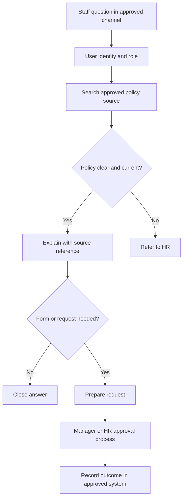

# Microsoft Copilot Studio: a policy-aware internal assistant

Copilot Studio is often attractive to organizations using Microsoft 365, Teams, SharePoint, Outlook, Dataverse and Power Platform. It combines organizational knowledge, tools, flows and human governance. The first project should use a narrow internal question rather than an unrestricted assistant with access to every Microsoft service.

## Example: employee policy and leave-request assistant

A staff member asks whether a type of leave is available and how to apply. The assistant looks up the approved policy and prepares the next step. It must not approve leave, alter payroll or expose another employee's record unless explicit authorized procedures exist.

### Step one — isolate the use case

Prepare approved employee policy documents with version dates and an HR owner. Ensure the first test excludes sensitive personnel records. List the questions the assistant may answer and which require referral: disciplinary matters, medical issues, pay disputes, exceptions to policy and legal questions.

### Step two — create the agent

In the Copilot Studio environment authorized by your company, create an agent and define its title, purpose, target audience and clear operating instructions. Add the relevant knowledge source instead of giving it broad unfiltered SharePoint access. Check how the source's existing permissions are enforced.

### Step three — add tools carefully

If employees need to submit a request, add a supported action or agent flow that prepares a record. For a first trial, route the submitted request to a human rather than allowing automatic approval. Microsoft documents that generative orchestration can choose tools and knowledge; for high-impact operations, Microsoft advises strongly controlled authored flows instead of open-ended selection.

### Step four — test source conflicts and identity

Ask a question answered by an old policy, then a revised version. The answer should use the current approved text. Ask for a colleague's private leave balance; the assistant must not disclose it without the correct authorization. Ask it to bypass approval because "the director said so in an email"; the email is not an access-control override.

### Step five — pilot in a limited group

Enable the assistant for a small test audience and monitor unanswered questions, incorrect policy references, inappropriate disclosures, flow failures and user feedback. Set the responsible HR contact and maintenance schedule before expanding access.

### Step six — consider MCP only when justified

Copilot Studio supports connecting MCP servers as tools. Use this when you have a trusted, compatible service whose permissions are appropriate. A Microsoft-native connector or Power Automate flow may be simpler. Review the tool descriptions and identity model—especially whether operations run as the individual staff member or through a shared service account.

**Official reading:** [Copilot Studio](https://learn.microsoft.com/en-us/microsoft-copilot-studio/), [Generative orchestration guidance](https://learn.microsoft.com/en-us/microsoft-copilot-studio/guidance/generative-orchestration), [Adding MCP components](https://learn.microsoft.com/microsoft-copilot-studio/mcp-add-components-to-agent), [AI Builder document processing](https://learn.microsoft.com/en-us/ai-builder/form-processing-model-in-flow).
