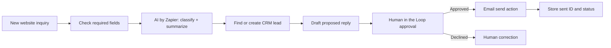

# Zapier: a review-first business process

Zapier is useful when a business already uses several common applications and wants a visible route from trigger to action. This example creates an inquiry record and asks a person to approve the outgoing reply. Product packaging changes; consult current help for **AI by Zapier** rather than assuming older standalone agent tutorials are up to date.

## Example: contact form to reviewed email

### Why approval is the design center

Zapier documents a **Human in the Loop** step that can pause a Zap, ask an authorized reviewer to approve, decline or edit submitted content, and then continue. The help article lists plan requirements and explains how reviewer notifications work. Those details are worth checking before designing a process that depends on the feature.

### Build the basic route

Create a Zap using your supported form trigger. Add a step to validate that the inquiry contains a name, a reply channel and a meaningful request. Add an AI by Zapier step to classify its intent; use a small set of categories, with an "uncertain" option. Search the CRM before creating a new record, because repeated form submissions are common.

Create an email draft or a text field containing the proposed answer. Include the actual source of any quoted price or policy. The owner should receive a review card with the proposed recipient, subject, body, source record and reason for sending. Place the approval step **before** the send action; never send first and request approval afterward.

### Important configuration checks

- Who can approve? Is the Zap shared with the reviewers as required?
- What happens after a decline? If the workflow continues accidentally, a rejected message may still be sent.
- Can reviewers edit the content? If so, which fields are logged as changed?
- What happens when approval sits unanswered for two days?
- Do retries create duplicate CRM entries or duplicate outgoing emails?
- Can the person who built the automation also approve sensitive actions without separate oversight?

### A small pilot

Use ten synthetic inquiries. Include one complaint, one request for a price not in the catalog, one attempt to request private customer information, and one duplicate. Approve five, decline two and leave three pending. Confirm that only the approved messages were sent and that every unresolved case remains visible.

**Official reading:** [Human in the Loop approval](https://help.zapier.com/hc/en-us/articles/38731463206029-Request-approval-to-keep-your-workflow-running-with-Human-in-the-Loop), [Zapier MCP](https://help.zapier.com/hc/en-us/articles/48308034391821-What-is-Zapier-MCP), [Zapier Help](https://help.zapier.com/).
