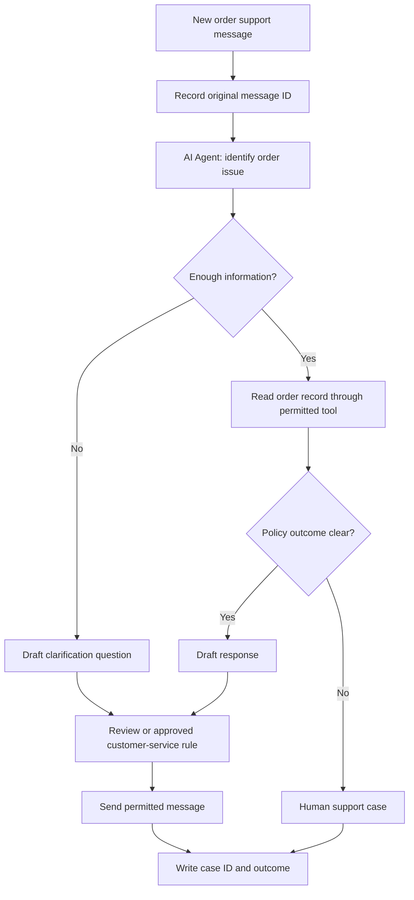

# n8n: visual workflows for owners willing to learn a little more

n8n has a visual editor, many integrations, and an AI Agent node that uses a model plus connected tools. It is often more flexible than beginner-oriented automation products, but configuration, hosting choices and advanced data mapping may be more involved. **No-code in a visual editor does not mean maintenance-free.**

## Example: order-support triage

### Setup outline

Start with the hosted or organizational deployment approved for your business. Create a workflow triggered by a test channel. Add the supported AI Agent node, then a compatible chat model and a **limited** lookup tool. The official n8n documentation explains that the Agent node uses connected tools and that its agent implementation is a tools agent.

Write instructions that require a strict outcome: `order question`, `delivery issue`, `return request`, `not enough information` or `other`. Do not expose a refund or bulk-delete tool during the first test. Add a standard action to create an internal support ticket.

### Human control

n8n documents a human-in-the-loop pattern for selected tool calls, including approval before executing a particular tool. Use it for an operation such as changing an order address or issuing a refund. This is better than giving an agent every write permission and hoping it asks politely.

### Test the tricky parts

Test invalid order IDs, the same message arriving twice, unavailable lookup service, partial tool output, an excessive loop, customer content requesting private records, and an approval request that never receives an answer. Observe the actual execution history and verify what changed in the external business system.

### When to choose another tool

If your team needs a polished call-center interface, specialist voice platforms may be simpler. If you need only "new form → spreadsheet row," ordinary automation is enough. If you need complex cross-system routes and the business can manage the operating responsibility, n8n may be worthwhile.

**Official reading:** [n8n AI Agent node](https://docs.n8n.io/integrations/builtin/cluster-nodes/root-nodes/n8n-nodes-langchain.agent/), [Human-in-the-loop for tools](https://docs.n8n.io/build/integrate-ai/ai-examples/human-in-the-loop-for-tools/).
