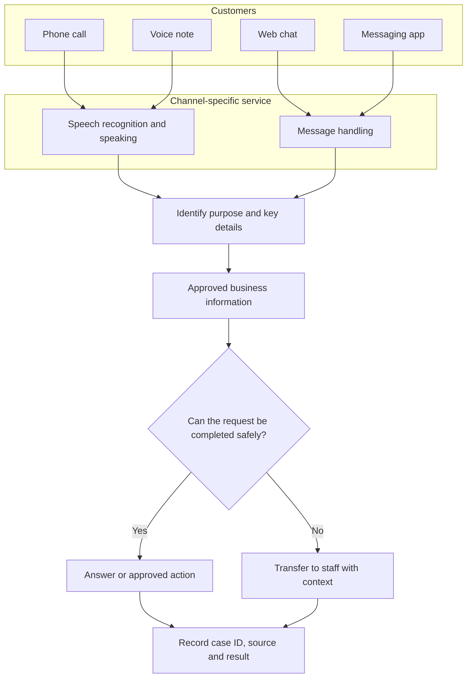

# Voice and messaging: choosing a front desk

A telephone receptionist, a web chat helper, and a WhatsApp assistant may appear similar to customers, but they have different operating needs. Use this guide to avoid selecting a tool solely because its demonstration sounds natural.

## The front-desk architecture

## Selecting a telephone service

**Voiceflow** is one candidate for designing voice and chat experiences with knowledge and integrations. **ElevenLabs ElevenAgents** is a candidate for real-time voice and conversational workflows. **Botpress** is a candidate for messaging and customer-service-oriented bots. Feature support varies by channel; do not assume that a tool's web-chat handoff works identically on a phone or WhatsApp deployment.

Before purchase, run calls that involve accents, background noise, interruptions, misspelled names, and a caller asking for a human. Measure delay between turns, successful handoff, ability to repeat key numbers, and availability of proper conversation logs. If your business has multiple languages, test each with actual users rather than relying on advertised coverage.

## Sample call: booking an appointment

| Person | Example exchange | System responsibility |
|---|---|---|
| Caller | “Can I come in tomorrow afternoon?” | Determine local date and branch |
| Receptionist | “Which service do you need?” | Gather service type |
| Caller | “A consultation, about thirty minutes.” | Confirm requested duration |
| Receptionist | “May I check available times?” | Search live calendar |
| Calendar tool | Returns permitted time slots | Do not invent times |
| Receptionist | “I can offer 2:30 or 4:00. Which works?” | Confirm one choice |
| Caller | “2:30.” | Prepare booking |
| Calendar tool | Creates appointment if authorized | Verify returned event ID |
| Receptionist | “You are booked for 2:30, confirmation number…” | Speak only after receipt |

If the calendar does not respond, the receptionist should say it cannot confirm and arrange staff follow-up. A convincing voice cannot create an appointment that is not in the system.

## Sample messaging case: return request

A buyer sends a photo of a damaged package. The system should ask for the order number, read the relevant purchase record and policy, and create a support case. It should not infer the refund amount from the image alone. If the policy requires a human inspection, send the evidence to the correct staff member.

## WhatsApp caution

Official WhatsApp Business Platform messaging rules can require approved templates outside customer service windows, and channel-specific handoff features vary across third-party platforms. For example, ElevenLabs' WhatsApp documentation currently flags human handoff as a feature still under development for that integration; verify that a claimed escalation path exists before depending on it in production.

**Official reading:** [Voiceflow](https://www.voiceflow.com/), [ElevenLabs ElevenAgents](https://elevenlabs.io/docs/eleven-agents/overview), [ElevenLabs WhatsApp limitations](https://elevenlabs.io/docs/eleven-agents/whatsapp), [Botpress](https://botpress.com/), [Meta WhatsApp Business policy](https://business.whatsapp.com/policy).
