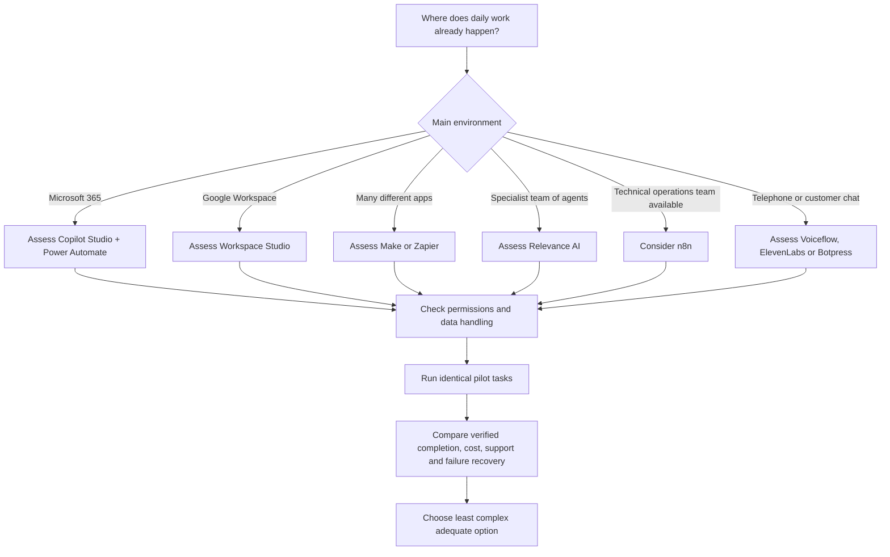

# Choose your platform with a real business test

Comparing screenshots is not enough. Choose a single workflow that matters to the business, then test it on two likely platforms with the same tasks and approval rules.

## The selection diagram

## Requirements to write before a vendor demonstration

| Requirement | What a useful answer looks like |
|---|---|
| Input channels | Exactly which email, chat, voice, forms, photo or document sources are supported |
| Business systems | Named connectors and the actions available, not just app logos |
| Authentication | Individual user rights or shared service credentials clearly explained |
| Approvals | Human can block a sensitive operation before it happens |
| Logging | Tool calls and their outcomes can be inspected |
| Errors | Retry, timeout and duplicate behavior is documented |
| Export | Business can retrieve its records and move away |
| Data terms | Retention, subprocessors, training usage, regional processing documented |
| Commercial model | Fixed fees and usage charges transparent |
| Customer support | Defined response channels and operational responsibility |

## A vendor demonstration script

Ask the seller to show how the platform: reads a specific record, refuses an unauthorized record, drafts an answer, requests approval, uses the correct sender account, displays a failed action, avoids duplicate processing after a retry, and lets the administrator disable access. If any step is answered only with a slideshow or promise, record it as **not yet verified**.

## Weighted decision—not a winner's badge

Choose weights relevant to the business. A medical administrator may place far more weight on privacy and auditability than on content-generation quality. A marketing agency may prioritize human creative review and client asset access. A service center may prioritize successful voice transfer and accurate scheduling.

A possible scoring sheet includes task reliability 30%, permission and privacy controls 25%, operational ease 20%, integration fit 15%, and total cost 10%. These are merely example weights. If a platform fails a mandatory legal or security requirement, do not let a high overall score compensate for that failure.

## Final decision memo

Write a one-page record with the problem, chosen platform, alternatives considered, evidence from the pilot, expected costs, data exposed, the named business owner, the exit plan and the next review date. The existence of this document matters more than a vendor logo on an impressive architecture diagram.

[See the vendor comparison template](../07-templates/07-vendor-questions.md) · [See the cost workbook](../11-workbooks/07-cost-calculation.md)
