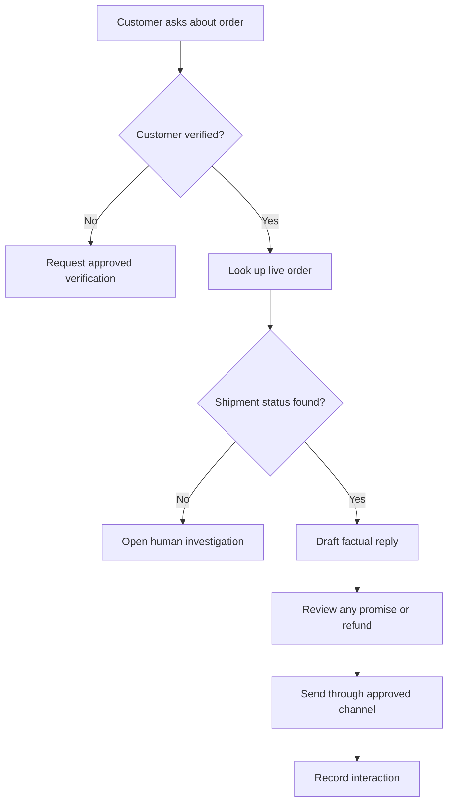

# Customer service: from a message to a resolved case

## Case A — "Where is my order?"

A customer writes: "Order 481 was meant to arrive yesterday. Where is it?"

### What the business needs

The order system, delivery status, customer identity, and current shipping policy. The system must not look up or reveal another person's order just because someone supplied a number.

### Division of work

| Specialist | Responsibility |
|---|---|
| Intake | Extract the order number and identify delivery question |
| Records lookup | Find the matching order and verify access |
| Operations | Retrieve the current dispatch or courier status |
| Response writer | Draft a reply using the verified status |
| Reviewer or support lead | Check any compensation or delivery promise |

### Example response after verification

> "Your order is showing as dispatched, but the courier has not yet confirmed delivery. I've asked our delivery team to investigate. We will update you through this support case when we have a confirmed status."

Do not substitute "It will arrive tomorrow" unless the delivery service actually provides that confirmed information.

### How to test it

Try a genuine order reference, a wrong reference, a reference belonging to a different customer, a courier outage, and a request for a refund. Confirm that the workflow never reports an invented delivery status.

## Case B — A damaged product photograph

A customer sends a photo showing a dented package and writes, "This arrived damaged."

A vision-capable service can describe the visible damage. The support assistant asks for the order reference and any policy-required photographs. It creates a case, attaches the supplied evidence, and proposes the policy-based next step. A staff member handles compensation or unusual return decisions.

**Why a picture helps:** It reduces typing and gives support staff useful evidence. **What a picture does not prove:** The source, cause, timing, or full extent of the damage.

## Case C — A customer sends a voice note in another language

Speech recognition produces a transcript, and a language model helps interpret the request. The support assistant looks up the relevant FAQ, prepares a reply in the customer's language, and marks technical or financially sensitive phrases for review.

Test local accents, language switching, and numbers such as order IDs. Ask the customer to confirm a misunderstood number instead of guessing.

## The simplest no-code pilot

Use a dedicated support inbox and an approved policy document. Let the system classify requests and draft answers in a shared review queue. Do **not** send automatically until the team has measured mistakes and escalation rates.

**Completion record:** customer reference, task ID, verified facts, approved response, sending confirmation, date, and next owner (if still open).

## When the customer says the answer is wrong

The system should not defend a mistaken statement merely because it came from a model. A customer correction becomes a case: find the original reply, compare it with the current order or policy, and ask staff to determine what happened. If the answer relied on an outdated document, the document owner must correct the source and retest the workflow.

### Three levels of customer service

An FAQ desk can answer approved opening hours and general rules. An order desk can provide authenticated order status from live records. A resolution desk can organize complaints, assess standard return policies and prepare recommendations. Do not give the first level broad access to refunds or personal records; escalation is healthier than pretending one assistant can decide everything.

### Sample service promise

> I can check the order status and explain our current policy. If the records are unclear or your request needs an exception, I will pass the case to the relevant staff member. I will not claim a refund or delivery has been completed unless the appropriate system confirms it.

[Detailed retail case](../09-case-studies/01-retail-voice-photo-sales.md) · [Delivery dispute](../09-case-studies/09-distributor-delivery-dispute.md)
