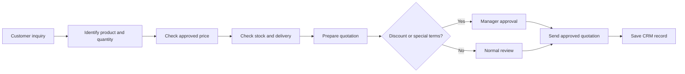

# Sales: enquiries, quotations and appointments

## Case A — A wholesale quotation

A shop asks: "Please quote 80 units of Product C, and can we receive them by the end of next week?"

### Records needed

Current catalog, customer price tier, stock availability, delivery capacity, approved discount policy, and quotation template.

### The workflow

### Example: make the calculation visible

For an invented list price of 25 per unit, 80 units total **2,000 before taxes or shipping**. A reliable workflow should calculate using an approved tool or verified spreadsheet, not rely on an unsupported free-form number. If freight is unknown, leave it explicitly pending.

### Important boundaries

- Never invent price or stock.
- Never offer an unapproved discount.
- Never promise a delivery date without checking capacity.
- Never claim the quote was sent until the mail service confirms it.
- Record which price list version was used.

## Case B — Booking a consultation

A client asks: "Is there a 45-minute session available on Thursday afternoon?"

The appointment assistant checks the staff calendar and service rules. It suggests openings returned by the calendar. The customer selects one. The booking action occurs only after the necessary customer details and permissions are confirmed, and the calendar returns a reservation or event ID.

**What if another staff member books that slot?** The final booking system determines whether it is still available. A suggested time is not a guarantee.

## Case C — A lead has gone quiet

A business owner asks: "Which prospects have not replied in seven days?"

A CRM-connected assistant reads open leads and last-contact dates, produces a list, and prepares follow-up drafts. It respects opt-outs, applicable marketing consent, and the messaging platform's rules. The sales manager chooses which messages should go out.

## What to measure

- Correct quotations with no manual correction.
- Time from inquiry to first useful reply.
- Number of qualified leads followed up.
- Changes to conversion rate, accounting for other factors.
- Incorrect promises, duplicates and opt-out mistakes.

**First pilot:** Draft five quotations against a test catalog. Compare every figure, rule and delivery condition with the source records. Only then consider connecting live CRM actions.

## Qualifying a lead without inventing a customer need

A lead registrar should collect what the customer actually stated: required product or service, intended timeframe, budget if volunteered, preferred contact channel and unresolved questions. It should not mark a prospect “ready to buy” merely because the customer replied politely. Lead qualification criteria are a business policy and may vary by product.

### An appointment is not a calendar suggestion

A booking workflow should identify the service, its duration, staff or room constraints, the customer's preferred date and actual available slots. A proposed time remains a proposal until the calendar returns a confirmed event. If the booking fails after the customer selects a time, the business should offer a follow-up rather than silently pretending success.

### Commercial controls

Discounts, unusual warranties, contractual commitments and sending mass marketing messages should follow explicit business approval and messaging rules. Treat the assistant as a way to reduce routine preparation work, not as an independent salesperson authorized to renegotiate terms.

[Full professional-services proposal](../09-case-studies/02-professional-services-proposal.md) · [Customer journey diagram](../10-diagram-atlas/06-sales-and-service.md)
