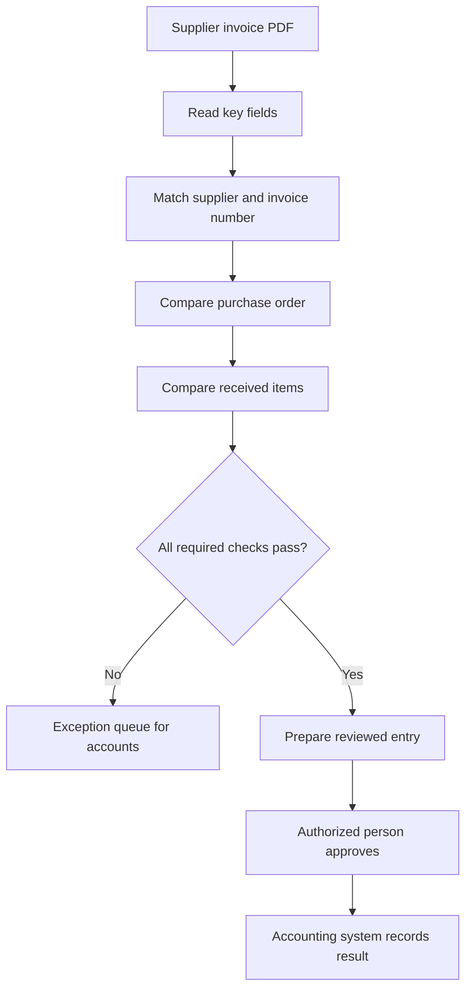

# Accounts: invoice reading without handing over payment authority

## Case A — A supplier sends a PDF invoice

The invoice contains a supplier name, invoice number, date, line items, tax, and total. A document-reading tool extracts those fields. An accounts assistant compares the invoice with the approved purchase order and receiving record.

### Example discrepancy

The purchase order approves 10 chairs at 75 each. The invoice shows 11 chairs. The assistant should flag a quantity difference. It should not adjust the purchase order to make the invoice match or silently approve the extra chair.

### What the assistant can do

- Extract standard fields.
- Identify duplicate invoice numbers for review.
- Compare totals and line items using a spreadsheet or calculation tool.
- Highlight differences in supplier name, quantity or dates.
- Create a review task with links to the original documents.

### What it should not do by itself

- Add or change bank-account details.
- Decide that an unfamiliar supplier is genuine.
- Approve the purchase or release funds.
- Ignore conflicts because the document looks official.

## Case B — Staff expense receipts

A staff member uploads a photograph of a receipt. The system extracts the date, merchant, amount and category, and checks whether required documentation appears present. If the photo is blurred, it asks for a clearer copy. A human reviewer handles unusual or policy-exception expenses.

## Case C — Monthly spending report

An accounts assistant reads an approved expense sheet and compares categories month by month. It identifies material changes and prepares a report. Finance reviews whether the change is genuine, whether a category was reclassified, and whether any amount was entered twice.

## A simple pilot

Use 20 anonymized invoices with known correct answers. Count missing fields, incorrect fields and false matches separately. An extraction rate of 95% may still be unacceptable if the 5% includes bank numbers or tax totals.

## Completion is more than extraction

A document is **processed** when it has an identifiable status, any discrepancies are visible, a responsible human has approved the appropriate action, and the accounting system confirms what was recorded.

## Three-way matching in plain language

Imagine a purchase order for 10 items, a goods-received note for 8 items and an invoice charging for 10. The invoice reader can extract every field correctly while the invoice still requires investigation. Three-way matching compares the supplier invoice against the authorized order and evidence of what the business actually received.

A missing delivery fee, changed bank detail, unexpected currency or duplicate invoice number should be recorded as an **exception**, not silently corrected. Finance owns the decision. The model can prepare a discrepancy note, but the accounting system should compute totals and the payment process should retain separate authorized controls.

### What success looks like

The outcome is a correctly classified draft payable, source document, matching result and named reviewer. It is not an automatically paid invoice. A good report also measures the number of invoices referred for real discrepancies, since a suspiciously perfect approval rate may mean checks are being skipped.

[Detailed invoice case](../09-case-studies/06-invoice-to-accounting.md) · [Finance diagram](../10-diagram-atlas/05-finance-and-invoices.md)
