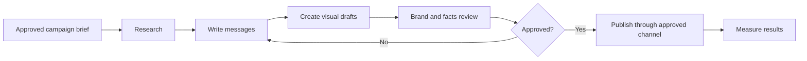

# Marketing: research, writing, visuals, and approval

## Case A — Launching a new service

A manager says: "We are introducing weekend maintenance appointments. Prepare a short campaign for existing customers."

The work involves distinct responsibilities:

| Role | Work product |
|---|---|
| Research | Customer concerns, market context, useful source links |
| Planner | Audience, message, offer boundaries and channels |
| Writer | Email and social-media drafts |
| Designer | Branded visual concepts |
| Reviewer | Checks factual claims, product images and policy rules |
| Marketing manager | Approves final distribution |

## A good campaign brief is specific

> "We are adding Saturday maintenance appointments. Customers can book online. Service operates 9 a.m.–2 p.m. We have no launch discount. Make one customer email, two short social posts and one square image concept. Use the approved brand colors. Do not imply same-day repair is guaranteed."

This is much more effective than "Make a great marketing campaign."

## Case B — Turning a long article into shorter content

The writer reads an approved original article and proposes a newsletter summary, a short post and a customer FAQ. A reviewer checks that the claims match the article. Do not reproduce large amounts of copyrighted third-party material or silently invent statistics.

## Case C — A promotional video

The creative assistant prepares a storyboard and script. A supported video-generation or editing service creates draft footage. The marketing team checks whether products, staff uniforms and business locations are depicted accurately. The final video is approved before publication.

**A warning about product visuals:** Never present a generated image as a literal product photograph if it depicts features the real item does not have.

## Case D — A multilingual campaign

One approved source message is adapted for different customer languages. A fluent staff member or qualified reviewer checks culturally important and legally sensitive wording. Marketing consent and platform rules still apply.

## The no-code starting version

Keep content creation in a document or design app. Store approved product facts and brand rules centrally. Let specialists produce drafts and record comments. Connect automatic posting only after you have a clear approval and rollback procedure.

## Useful measures

Time to approved draft, factual corrections per asset, production cost, customer engagement, qualified inquiries, and whether the campaign produced incremental business value.

## Three kinds of claim to keep separate

A product fact is something stated in an approved specification. A customer quote is a testimonial subject to consent and context. A creative concept is a proposed story or image. The creative team must not turn a concept into a factual product promise without evidence.

For instance, a generated advertisement could depict a refrigerator with controls or accessories the actual model lacks. Even if the design looks attractive, it misrepresents the product. Use approved product photographs for literal representation; distinguish conceptual visuals from real product imagery.

### Why publishing is a separate role

Drafting a caption, approving its claims, authorizing paid spend and publishing it are distinct tasks. An assistant may produce multiple options and prepare a schedule, but a named marketing owner should decide what reaches customers. After publication, track outcomes and customer questions so future content is based on observed performance rather than repeated fashionable phrases.

[Campaign production case](../09-case-studies/10-marketing-campaign-production.md)
