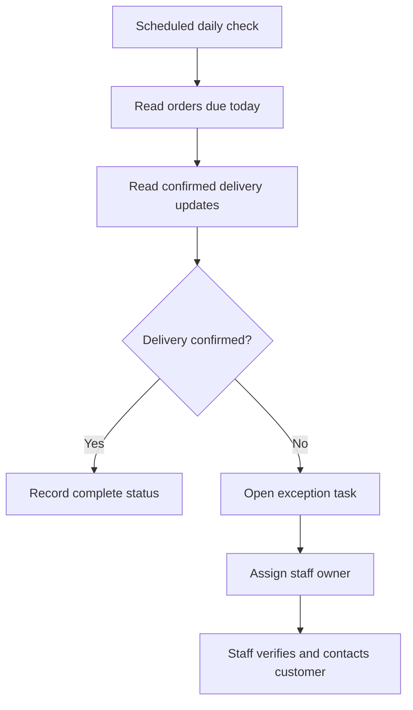

# Operations: orders, delivery, suppliers, and exceptions

## Case A — A delayed delivery

An operations manager asks: "Which deliveries due today have not been confirmed?"

The assistant reads the order tracker and courier records. It prepares a list of exceptions with the order reference, last confirmed status, promised delivery date, and responsible staff member. It does not guess the reason for the delay.

## Case B — Supplier quotation review

A purchasing team receives offers from three suppliers. One is cheapest but has a longer lead time. Another has a low unit price but requires a large minimum order. The assistant puts the offers in the same comparison structure and points out incomplete terms.

A human purchasing lead decides. The assistant should never replace the company's purchasing authority.

## Case C — Stock below a threshold

For each product, the system compares current inventory against approved reorder levels. It can create a draft purchasing queue. It should not order automatically merely because a quantity is below a threshold: outstanding orders, seasonal demand, budget, and supplier issues may change the decision.

## Case D — A maintenance report with a photo

A technician sends a picture and voice note: "The machine is leaking near this joint." A multimodal intake step transcribes the note, attaches the photograph and creates a maintenance ticket. It may describe what is visible, but an appropriately qualified technician decides whether equipment is safe to run.

## Case E — A supplier changes bank details

The assistant must **not** treat an emailed bank-detail change as verified. Route it to the company's independent supplier-verification process. A malicious message can look like a routine request.

## Operational records to keep

| Field | Reason |
|---|---|
| Unique work ID | Prevent duplicate processing |
| Original source | Staff can verify the report |
| Last confirmed status | Avoid mistaken promises |
| Responsible person | Someone owns unresolved issues |
| Next action and deadline | Prevent stalled jobs |
| Approval evidence | Show why a restricted action occurred |

## Start here

Build a **read-only daily exception report**. Avoid automatic stock adjustments and supplier orders until your underlying records have been validated over time.

## Operational events are often disputes between records

A courier marks a parcel delivered while the customer says it never arrived. A warehouse count says an item is available but the order system shows it reserved. A supplier invoice claims a price change that is not in the contract. In each case, a polished answer cannot resolve contradictory evidence. The assistant should identify the records, their retrieval times and the responsible person who can investigate.

### Keep execution separate from explanation

A distribution assistant may explain live shipment status. It should not alter a carrier's tracking record. A maintenance clerk may create a ticket based on an operator's voice note, but it cannot determine that machinery is safe to operate. A supplier comparison assistant can show terms and omissions; the owner decides which contract to sign.

[Delivery dispute case](../09-case-studies/09-distributor-delivery-dispute.md) · [Factory maintenance case](../09-case-studies/12-small-manufacturer-maintenance.md)
