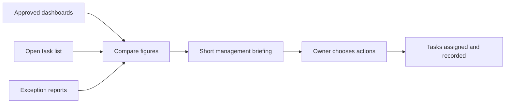

# Research and management reporting

## Case A — Compare potential locations

A business owner considers opening a new branch and asks for an initial comparison of three areas.

The research assistant gathers publicly available information: population indicators, local competitors, access routes, commercial-property listings and relevant permits. It should cite the date and source for each finding and distinguish reported facts from estimates.

The business owner then checks the numbers through site visits, direct quotes, professional advice and local market knowledge. Research does not establish that a location will be profitable.

## Case B — Weekly management briefing

The owner says: "What needs my attention this Monday?"

A management assistant reads selected approved records and produces:

1. Deliveries or service cases past their deadlines.
2. Quotes awaiting approval.
3. Invoices with unresolved discrepancies.
4. New customer complaints requiring action.
5. Decisions that need a named manager.

It should include links back to the original records. If a connection failed, it must state that the report may be incomplete.

## Case C — Competitor observation

A marketing manager asks for a monthly comparison of competing service packages. The assistant reviews public product pages, records what each source says, and notes where a price is unavailable. It must not present an old offer as current without checking.

## Case D — Board or investor updates

An assistant can help draft an update using approved financial and operational figures. The responsible officers should validate every material number and forward-looking statement. The system should not produce invented growth rates or imply that estimates are audited.

## Model choice

A higher-reasoning general model may help reconcile complex documents. A search-enabled research tool may help discover sources. A spreadsheet tool should handle calculations. The best workflow can use each where appropriate rather than asking one model to do everything from memory.

## What makes research trustworthy?

For each claim record **source, publication or observation date, limitations, and level of certainty**. If two sources disagree, show the disagreement rather than picking one silently.

**First pilot:** Prepare a weekly summary from three clean internal sources. Have management score completeness, accuracy, and usefulness before automating delivery.

## A management report should have three clearly labeled sections

**Facts:** Counts, amounts and dates drawn from identifiable business records. **Interpretation:** Possible reasons for changes, with uncertainty. **Decisions or questions:** Actions the owner might consider and what evidence is still needed. Mixing these sections encourages speculation to be treated as a company result.

A monthly sales report can show that completed orders declined. It cannot automatically establish that customer demand declined; the explanation could involve stock shortages, changed pricing, incomplete records or slow fulfillment. The research role should investigate possible causes and point the owner toward confirming evidence.

### A researcher's source habits

Record the publisher, date, geography and actual claim of each important source. For recent market information, prefer current primary sources where possible. Label unavailable information rather than manufacturing a market share or competitor price. Public websites are evidence, not valid instructions for the assistant to use private business tools.

[Deep research method](../08-deep-dives/17-research-and-fact-checking.md)
