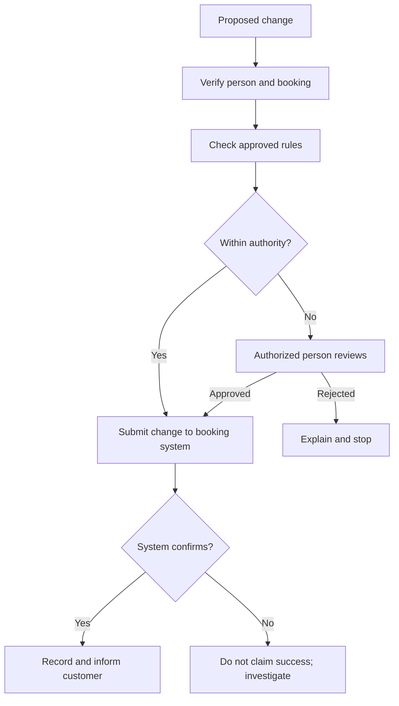

# Approvals and permissions: who can do what?

Good automation does not mean removing humans from decisions. It means giving people the right work at the right moment.

## A practical authorization table

| Action | Default first-pilot rule | Reason |
|---|---|---|
| Read a public product description | Allowed | Low sensitivity |
| Search an approved policy folder | Allowed with access controls | Reliable internal information |
| Create an internal draft | Allowed | Reversible and easy to review |
| Label an email | Allowed in a restricted folder | Low-risk organization |
| Create a new task | Allowed after checking for duplicates | Routine but must be tracked |
| Update customer details | Restricted | Risk of changing the wrong account |
| Send a quotation | Human approval | Business commitment |
| Publish an advertisement | Human approval | Brand and factual claims |
| Send marketing messages | Human approval and consent checks | Channel and privacy obligations |
| Approve a refund or payment | Authorized human only | Direct financial consequence |
| Change supplier bank details | Separate verified human process | Fraud risk |
| Delete records or change access rights | Authorized human only | Hard to reverse |

The table is a recommended starting policy. Adjust it for your industry, regulations and existing internal controls.

## Approval should be meaningful

A good approval request shows:

1. The exact action that will occur.
2. The affected customer, supplier or record.
3. The data and source used.
4. The money, deadline or external commitment involved.
5. Any unresolved uncertainty.
6. A clear approve / reject / ask for more information choice.

A vague button saying "Continue" is not enough for a high-risk decision.

## Example: changing an appointment

The assistant may find a booking and prepare a proposed change. The customer must be properly identified, the target time must be available, and the authorized person must approve if required. The calendar tool must return a confirmed update before anyone tells the customer the change is complete.

## Prevent approval fatigue

If employees are asked to approve hundreds of harmless labels, they will stop paying attention. Keep low-risk actions narrow and automatic, and reserve human judgment for consequential or uncertain cases. Periodically review what is generating approvals.

## Separation of duties

For sensitive money movement, it is often wise for the person requesting a payment to be different from the person approving it. Do not let a digital account impersonate both people. Preserve the company's existing financial controls.

Use the [permission register](../07-templates/04-permission-register.md) to document the actual settings.

## The difference between agreeing and authorizing

An employee who clicks **Approve** should be shown the action that will actually happen: the correct customer, amount, account, product, recipient or date. “Approve the assistant's recommendation” is too vague for a sensitive operation. For a quotation, show the product codes, price source, discounts, delivery promise, recipient, and exact outgoing message. For a record change, show the field's old value and proposed new value.

### Approval design for three common jobs

| Job | What the reviewer sees | What the system should do after rejection |
|---|---|---|
| External quotation | Items, quantities, verified unit prices, validity period, draft message | Do not send; return to Sales with reason |
| Invoice entry | Supplier, invoice number, PO reference, amount, duplicated status | Do not post; open an exception task |
| Event cancellation | Event ID, organizer, affected attendees, reason | Leave event unchanged and log rejection |

An approval is not just a pause: the downstream action must use the **approved version** of the data. If a draft changes after approval, it needs another review. Some products allow reviewers to edit fields directly; others require returning to an earlier step. Test whichever behavior your chosen product supports.

### Four permission mistakes to guard against

- Connecting an owner's full-access personal account to a routine mailbox sorter.
- Granting a whole workspace when one folder or calendar would suffice.
- Assuming an instruction such as “never delete” prevents deletion even when the connected tool permits it.
- Treating permission to prepare a message as permission to send it.

A practical first pilot can keep **read** and **draft** rights enabled and defer **write** and **send** rights until evaluation shows they are required. See the [MCP permission lab](../08-deep-dives/02-mcp-permission-lab.md) for step-by-step negative tests.
