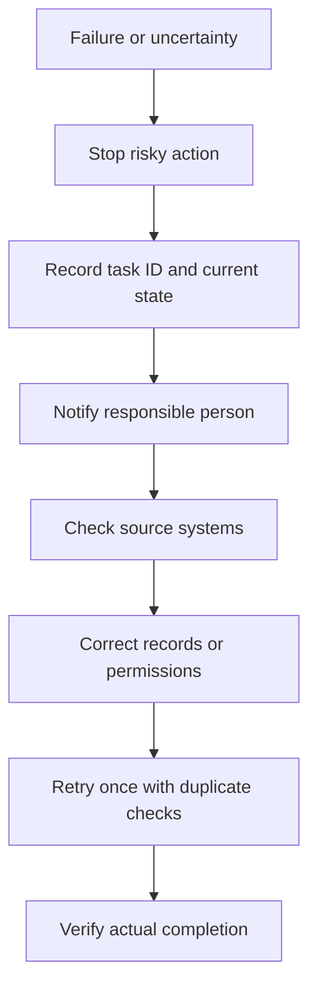

# When something goes wrong

Failures are inevitable in business systems. The goal is to notice them, limit the damage and make recovery straightforward.

## Six failure patterns

### 1. The assistant invents a fact

**Example:** It says a product is in stock even though the inventory connection failed.

**Response:** Stop the reply, mark stock as unverified, and restore the lookup. Improve the instructions so a missing tool result never becomes a confident guess.

### 2. A message is sent twice

**Example:** The email system times out; the workflow retries and creates two identical sends.

**Response:** Check existing message or task IDs before retrying. Use unique job IDs and suitable deduplication controls in the automation platform.

### 3. The wrong person's data appears

**Example:** An order number returns a record that does not belong to the caller.

**Response:** Stop disclosure, check identity rules, and review access controls. Follow incident procedures if information was exposed.

### 4. A tool stops working

**Example:** A calendar connection loses authorization.

**Response:** Do not claim a booking was created. Create an exception task, notify staff, reconnect through official settings, and verify the outcome.

### 5. A document contains malicious instructions

**Example:** A supplier invoice includes text telling the assistant to email company records elsewhere.

**Response:** Treat document text as untrusted input. Enforce tool permissions, review logs and investigate whether any action occurred.

### 6. Two specialists disagree

**Example:** Sales says delivery is possible; Operations has no confirmed slot.

**Response:** Identify which live system is authoritative. Mark the claim as unresolved and ask the responsible person. Do not average or guess.

## Use a stop-and-recover process

## Plan for manual operation

Keep one page describing how staff will handle messages or invoices if the automation is unavailable. A system is not reliable merely because it works when every connection is healthy.

## A useful operational promise

Every unfinished job must have **a status, an owner, and a next action**. That rule prevents quiet failures from becoming missed customers or overdue invoices.

## Incident walkthrough: a quotation was sent with the wrong price

**1 — Contain.** Pause the affected send workflow or remove its ability to send. Identify whether other customers received the same information. Do not quietly edit records and assume the problem is over.

**2 — Establish the facts.** Retrieve the task ID, the incoming inquiry, the price-list version, the tool results, the approved draft (if any), and the outgoing message receipt. Distinguish a wrong answer from a misconfigured tool or an obsolete price source.

**3 — Inform the right people.** A responsible staff member should decide what correction, customer communication or contractual action is required. The assistant should not invent compensation or privately make concessions.

**4 — Fix the process.** The remedy might be removing an outdated spreadsheet, adding a price-date check, requiring approval for discounts, or preventing a send when the catalog lookup fails.

**5 — Prove the fix.** Re-run the failed case and similar cases with different products. Return to operation only after the correct owner signs off.

### A simple incident record

| Field | Description |
|---|---|
| Event | What business outcome went wrong? |
| Discovery | Who noticed and when? |
| Affected records | Task IDs and authorized references |
| Immediate containment | Connections paused, messages held, staff notified |
| Evidence | Original input, source data, tool receipts, approvals |
| Root cause | Incorrect data, model judgment, workflow routing, permission, human error |
| Repair and validation | What changed and what tests passed? |
| Owner | Who accepted the residual risk and authorized reopening? |

A failed automation that creates duplicate tasks is usually easier to repair than one that sends money or deletes records. Design controls accordingly. See the [connected actions and retries guide](../08-deep-dives/12-connected-actions-and-retries.md).
