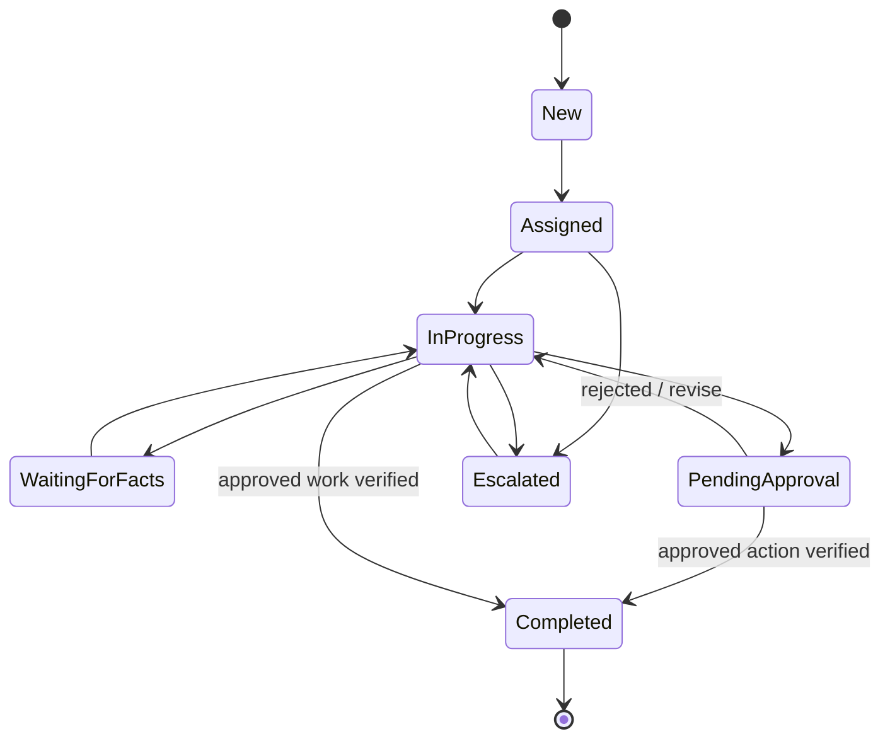

# Template: shared task register

A task register can be kept in an existing spreadsheet, ticketing system or project board. This Markdown table is a design template; it is **not** itself a live database.

| Task ID | Source | Request | Status | Verified facts | Assigned owner | Next action | Approval | Completed action ID |
|---|---|---|---|---|---|---|---|---|
| Q-104 | Sales inbox | Quote 20 units of B | Waiting for information | Product identified | Operations | Verify stock | Quote approval pending | — |
| S-205 | Support form | Parcel arrived damaged | In progress | Photo received | Support lead | Confirm order | Refund requires approval | — |
| [ ] |  |  |  |  |  |  |  |  |

## Approved statuses

- **New** — Received but not yet assigned.
- **In progress** — An owner is actively working on it.
- **Waiting for information** — A needed fact or record is missing.
- **Waiting for approval** — A person must decide.
- **Completed** — Final action is confirmed and recorded.
- **Needs human help** — Automated processing cannot safely continue.

## Rules for using the register

1. Every task gets a unique ID.
2. Every open task has a named owner or team.
3. Important facts link back to their sources.
4. An action is marked complete only after confirmation.
5. Retries must check whether an equivalent task already exists.
6. Open tasks are reviewed on a schedule.

For customer or staff records, apply your company's access and retention controls. Never publish live task registers containing private information to a public GitHub repository.

## Use an explicit task life cycle

Add a separate **failed** or **cancelled** status if your organization needs one. A task should not be marked completed merely because an AI tool generated a sentence saying “done.” Require the actual connected application's record ID or a human sign-off.

### Duplicate prevention

For email-triggered tasks, retain the source message ID; for web forms, retain the submission ID; for invoices, check supplier and invoice number. When an identical event arrives twice, update the existing task rather than starting a second charge, booking or customer record. If the platform cannot do this reliably, require human review before consequential actions.
