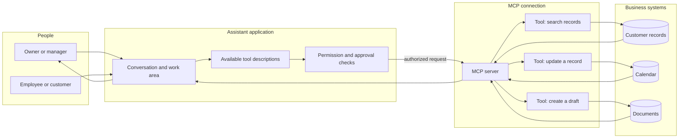
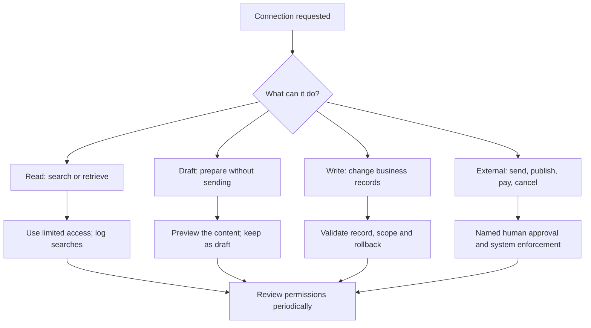
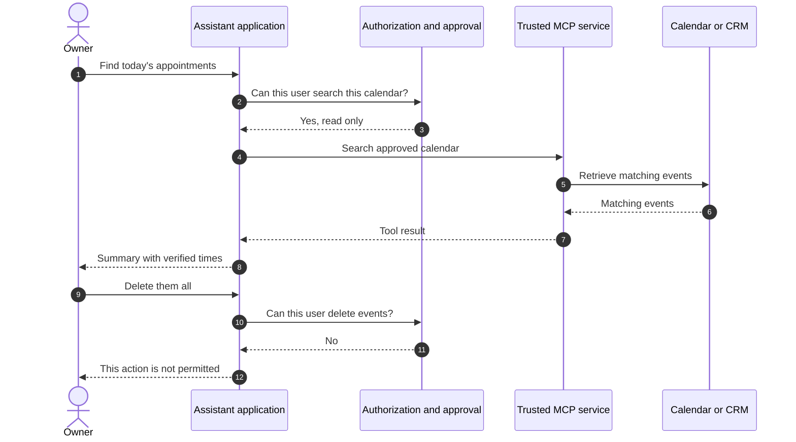

# MCP, explained from the business owner's chair

**Purpose:** Learn what a Model Context Protocol connection does, when to use one, how permissions work, and how to decide whether it is appropriate for your business—without building a server or writing a line of code.

MCP is short for **Model Context Protocol**. It is an open standard for making business information and actions available to an assistant through a consistent connection. The standard defines how a tool can be described, discovered and invoked. It does **not** provide a database, a company account, a permission policy, or an employee. Those still have to exist.

Think of a hotel receptionist. A receptionist does not know which rooms are free by memory. They check the booking system. They cannot simply move money out of the hotel's bank account because a caller asks them to. They work through approved systems, and their authority is limited by their role. A connected business assistant should operate the same way.

## The big picture

**Read the diagram from left to right.** A person makes a request. The assistant selects an available tool. The application and connection check permissions. A business system returns a result. Only then can the assistant say that an action occurred. A reply that merely *claims* a calendar was updated is not proof of an update.

## The three MCP building blocks

| Building block | Everyday translation | Typical example | What it does not mean |
|---|---|---|---|
| **Tools** | Actions the connected application can request | Search CRM, draft an email, create a calendar event | Unlimited authority to use the entire app |
| **Resources** | Reference material made available for reading | A product list, handbook, policy page | A promise that the content is current |
| **Prompts** | Reusable starting instructions | Prepare a meeting brief | A security control or a replacement for tool permissions |

The protocol also describes the roles of the application **host**, its **client** that communicates with the server, and the **server** exposing capabilities. These are useful terms when evaluating a provider, but owners rarely need to configure these components manually. The provider can manage them behind a connection screen.

## Six real business requests: what actually happens

### 1. “Show me tomorrow's appointments”

This is primarily a *read* request. The assistant calls a calendar search tool and returns the dates, times, and relevant attendees permitted for that user. A good setup may hide private event details and respect each employee's calendar access. The system should not infer availability from an old screenshot.

### 2. “Draft a reminder for these three customers”

Reading records and **creating drafts** can be separate permissions from **sending**. A prudent first version lets the assistant gather relevant appointment details and prepare three messages. A manager reviews the names, dates and wording. The send action is not enabled until that workflow is tested and approved.

### 3. “Create a sales opportunity from this email”

The assistant reads a customer email, extracts the company name and request, looks for an existing record, and proposes a new opportunity. Duplicate checking must happen before creating a record, or a repeated email can create two opportunities.

### 4. “Change the price of every item in this catalog”

This is a **bulk write** action with a high impact. The application should demand an independent list of proposed changes, a preview, an authorized decision, and a recoverable record of the old prices. If the available connection cannot constrain the tool to a safe subset, do not connect it for this job.

### 5. “What did we agree with Supplier X last month?”

The assistant could search email or files, but the retrieved messages are **evidence**, not instructions. A forwarded email could contain fraudulent directions. Answers should cite the relevant records and identify when a decision is not documented.

### 6. “The supplier emailed new bank details; update the records”

Do **not** let a message trigger this change automatically. A bank-detail change should follow an independent verified contact channel and the company's dual-control procedure. Reading an email through MCP does not make that email trustworthy.

## Read, draft, write, send: four different degrees of power

These labels are a management tool. A vendor may expose tools with different names or bundle several operations together. Always inspect the actual action list rather than trusting a descriptive name like “CRM helper.”

## How an owner adds a ready-made MCP connection

1. **Write the task on paper.** For example, “Find appointments and prepare reminder drafts.” Record what the assistant should *not* do: cancel meetings, invite unknown people or send messages unapproved.
2. **Check the assistant application's connection catalog.** Look for the official connection to the calendar or a trusted provider. Some products call these connectors, apps, integrations or MCP servers.
3. **Read what access is requested.** A connection that asks for all files or full account control may be too broad for the intended task. Ask your administrator or provider whether a narrower scope is possible.
4. **Connect a test account or a limited staff account first.** Do not begin with the owner's personal inbox and all permissions.
5. **Verify available actions.** Open the connection details and read the tool names. Can it only search? Can it create and delete? Does it ask for confirmation? What happens after a denial?
6. **Try five ordinary requests.** Check actual calendar or CRM records before accepting “done” as proof.
7. **Try five unwanted requests.** Ask it to delete an event, expose another customer's record, or change a price. Those attempts should be rejected or stopped by enforced controls.
8. **Turn on appropriate logs.** Retain enough detail to investigate mistakes while following your retention policy.
9. **Assign an owner.** Someone must regularly review access, tool additions, and failures.

### What if the assistant asks for an MCP server URL?

That usually means you are adding a *custom remote connection*. You need a real server address maintained by a trustworthy provider. Do not paste an arbitrary URL copied from social media. Verify the publisher, service owner, domains, permissions, privacy terms, and intended tools. Some platforms reserve custom connector management for particular paid plans or administrators. A business owner does not need to host a server to learn MCP; start with a supported built-in connection.

### A good first exercise: calendar, with no write access

| Test | Request | What a safe result looks like |
|---|---|---|
| A | Show my appointments for tomorrow | Reads only authorized events |
| B | Who is free at 3 pm? | Checks actual availability or states it cannot |
| C | Book a meeting | Stops if the connection lacks create permission |
| D | Cancel a colleague's meeting | Refuses when authorization is missing |
| E | Summarize private meeting notes for an outsider | Does not disclose content without authorization |

## When MCP is not the right choice

A standard built-in app connection can be simpler and sufficient. A visual automation can be better for a guaranteed sequence such as “When invoice received, save attachment, notify manager.” A manual checklist can be safer for a rare high-impact decision. MCP is useful when the assistant needs **discoverable tools across systems**, not because every workflow must use a protocol.

| Need | Prefer starting with | Why |
|---|---|---|
| One fixed trigger and a predictable series of steps | Built-in automation | Easier to inspect and repeat |
| An assistant asking different questions about several systems | Approved MCP tools or connectors | Flexible tool selection |
| A few company documents | Native file upload or document search | Less complexity |
| Human review of invoices | Document processing plus approval | Better separation of extraction and payment |
| Rare sensitive bank change | Human-controlled procedure | A connected assistant introduces unnecessary risk |

## How to examine the trust boundary

Notice that refusing a deletion is **not** a matter of good manners. The operation must be unavailable or rejected at the permission boundary. An instruction telling an assistant to “always say no” is useful guidance, but is not a secure access-control mechanism.

## Questions worth asking a provider

- Is this an official supported integration or a community-maintained server? Who operates it?
- Do permissions follow the individual user's account, or is one shared credential used for everybody?
- Can the business disable write tools and restrict folders, fields and projects?
- Are new tools automatically made available after updates? Can they be reviewed before activation?
- Where are records, prompts, tool inputs and logs stored? How long are they retained?
- How are secrets protected, and what happens if an employee leaves?
- What does a failed or partially completed action look like? Are there receipts or activity logs?
- Can the connection be removed without losing the underlying business records?

## Official reading

- [MCP: what the standard is](https://modelcontextprotocol.io/docs/2026-07-28/getting-started/intro)
- [MCP server concepts: tools, resources and prompts](https://modelcontextprotocol.io/docs/2026-07-28/learn/server-concepts)
- [MCP architecture](https://modelcontextprotocol.io/docs/2026-07-28/learn/architecture)
- [MCP security best practices](https://modelcontextprotocol.io/docs/2026-07-28/tutorials/security/security_best_practices)
- [Claude remote connectors](https://support.claude.com/en/articles/11175166-get-started-with-custom-connectors-using-remote-mcp)
- [Microsoft Copilot Studio and MCP](https://learn.microsoft.com/en-us/microsoft-copilot-studio/mcp-add-components-to-agent)

[Next: The MCP permission lab](02-mcp-permission-lab.md) · [Related: Choosing between MCP and built-in automations](../03-connections/04-which-connection.md)
