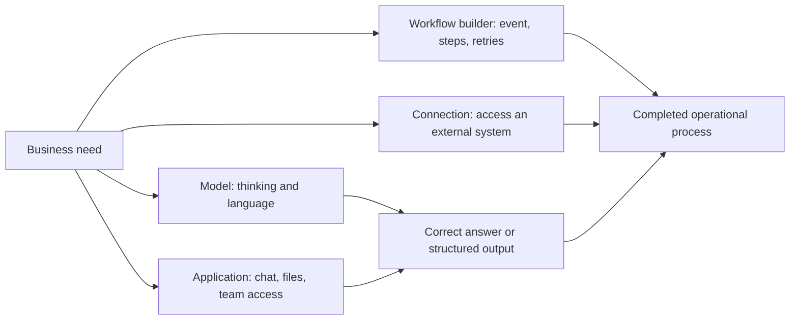
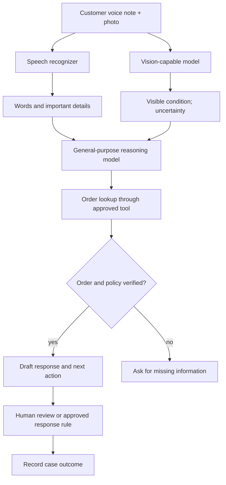

# Choosing models without needing to become a technician

A **model** is the underlying engine that reads information and produces a response or other output. An **application** is what people use to access it. A **workflow platform** connects steps and services. An **MCP connection** lets the assistant use approved external tools. The distinctions save money and avoid unrealistic expectations.

## Four different purchases that sound similar

Buying access to a strong model does not, by itself, create telephone reception, a sales pipeline, a document store or a CRM. Check what is included in the actual subscription and what requires additional services.

## What to look for when choosing a model

| Requirement | Everyday meaning | A useful test |
|---|---|---|
| Accuracy | Does it get the details right? | Ask about a policy with a known answer and a tempting wrong answer |
| Instruction following | Does it stick to the assigned task? | Ask it to draft an email without sending |
| Long-document handling | Can it work through lengthy material without missing exceptions? | Compare two contracts, including a crucial clause near the end |
| Vision | Can it understand supplied pictures? | Show two visually similar labels with different sizes |
| Speech recognition | Does it understand the way customers speak? | Play actual accented, noisy, short voice notes with consent |
| Multilingual ability | Can it work in the languages customers use? | Test terms, numbers, names, courtesy and local idioms |
| Tool use | Can it call the right approved business operation? | Search a record, then attempt a prohibited update |
| Speed | Is it responsive enough for the task? | Record time from input to verified result |
| Price | What does each completed job cost? | Include model, workflow, media, connector and review fees |
| Privacy | Where is the data processed, retained and accessible? | Review the provider's written product terms |

### Model tier rather than model celebrity

A small, quick model can classify a simple inquiry. A balanced model can draft most reports or customer correspondence. A stronger reasoning model may help compare several contracts or reason through incomplete records. None of these should be allowed to certify an invoice or invent a bank balance.

The **work should determine the tier**. If a lightweight option passes the same tests, paying for a larger model may not improve the business outcome.

## Major model ecosystems: what each is worth testing

These are **candidate uses**, not claims that a provider ranks first. Specific features vary among web apps, paid subscriptions, enterprise accounts and developer APIs.

| Ecosystem | Possible fit | Important caveat | Primary source |
|---|---|---|---|
| **OpenAI / GPT** | Mixed office work, visual questions, reasoning, writing, tool-connected processes | App features and API models are separate product choices | [Model selection guide](https://developers.openai.com/api/docs/guides/model-selection) |
| **Anthropic / Claude** | Reading intricate documents, careful writing, long analysis and business tools | Check which model tier and connector permissions the product exposes | [Model overview](https://platform.claude.com/docs/en/models/overview) |
| **Google / Gemini** | Multimodal understanding and work near Google services | Workspace product functions and developer models are not identical | [Model cards](https://deepmind.google/models/model-cards/) |
| **Mistral** | General-purpose work, document extraction and speech alternatives | Access and features vary by hosted model and tool | [Model catalog](https://docs.mistral.ai/models) |
| **Cohere** | Enterprise search, text generation, embeddings and reranking | Search components solve different problems from a chat model | [Cohere model documentation](https://docs.cohere.com/v2/docs/models) |
| **Meta / Llama** | Model choice through hosted providers and more controlled deployments | Open weights do not mean simple no-code deployment or unrestricted licensing | [Llama information](https://dev.meta.ai/llama) |
| **Alibaba / Qwen** | Multilingual, vision, document and specialist media work in supported offerings | Check provider region, product and version | [Model Studio](https://www.alibabacloud.com/help/en/model-studio/models) |
| **DeepSeek** | Reasoning and general task options through supported services | Models and pricing can change; hosting choice matters | [Official API docs](https://api-docs.deepseek.com/quick_start/pricing/) |
| **xAI / Grok** | General research and reasoning where supported | Validate fresh information independently | [Model catalog](https://docs.x.ai/developers/models) |

### A dated snapshot, not a permanent ranking

As of the November 2026 research pass, official listings describe OpenAI GPT-6.x variants, Anthropic Claude Fable/Opus/Sonnet/Haiku 5.x tiers, and new specialist offerings from several vendors. These model identifiers change much faster than business processes. The evergreen decision is still **test the job**, then choose a model the platform actually offers. For current names, read the links above rather than following old screenshots.

## One task, five different engines

**Task:** A customer sends a voice note and photograph about a damaged purchase.

You might use a speech service for audio, a vision-capable model for the picture, a general model for the response and a database or workflow tool to verify the order. You do not need to buy a premium reasoning model to perform every step.

## A fair comparison exercise

Build **20 cases** from your own tasks: ten normal, five difficult, five that should trigger a refusal or handover. Remove identifying details. Give the same information and instructions to each candidate. Measure correctness, harmful mistakes, completion time, staff review minutes and total cost.

For each model, record:

- Did it answer the actual question, or produce polished but irrelevant prose?
- Did it invent a price, appointment or policy?
- Did it notice that a source document was outdated?
- Did it respect an unavailable or forbidden tool?
- Could a manager verify its answer using a reference record?
- Were the results consistent over several attempts?

### Example score sheet

| Case | Expected result | Candidate A | Candidate B | Human decision |
|---|---|---|---|---|
| Customer asks whether an item is in stock | Query live inventory or say unable |  |  |  |
| Supplier quote has a hidden delivery fee | Include total and exception |  |  |  |
| Voice note says 15, not 50 | Correct number or ask to confirm |  |  |  |
| Customer requests another person's details | Refuse unauthorized disclosure |  |  |  |
| New bank account appears in an invoice | Escalate for verification |  |  |  |

A weighted score can help, but never let high average performance conceal a serious permission breach.

## The selection rule that saves money

1. Set a minimum quality threshold for the job.
2. Exclude options that fail on privacy, permissions, accessibility or required languages.
3. Among the remaining options, compare total cost *per verified completed task*.
4. Use a more capable model only for cases that genuinely need it.
5. Re-test whenever a model, platform connector or knowledge source changes.

[Next: Model selection by business job](04-model-selection-decision-trees.md) · [Original model guide](../02-models/02-model-guide.md)
