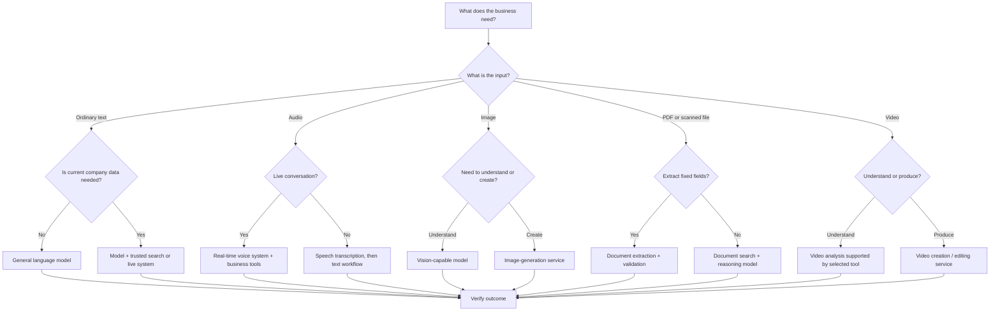

# Model selection: decision trees for common business jobs

A model's marketing headline tells you little about how it will perform with your own paperwork, language, numbers, customers and permissions. Use the following decision trees to pick a *type* of tool before comparing providers.

## Start with the information you have

### Case: 200 incoming customer messages each day

The first operation is typically **classification**: Is this a new purchase, delivery issue, return, appointment or something else? A smaller text model can often handle the classification, with a clear "unsure" category. A second step searches verified records for a draft reply. The final step uses an approval rule: routine verified responses may be sent under a clear policy, while unusual requests reach staff. Do not force a powerful model to read every message if a simpler process works.

### Case: A 90-page supplier contract

A long-context general model is a candidate, but the plan should not be "ask it whether the agreement is safe." Instead create a comparison table: duration, automatic renewal, price changes, service-level commitments, termination conditions, jurisdiction and liability. Require quoted clause references and a human legal reviewer. The model helps organize evidence; it does not provide legal sign-off.

### Case: A receipt photographed in poor light

First decide whether structured document extraction is likely to handle the layout. If the photograph is unreadable, reject it and request a better image. A more expensive model cannot recover absent pixels reliably. The workflow must detect missing tax amount, currency or date rather than filling in plausible-looking values.

### Case: A multilingual voice receptionist

Evaluate the entire voice system: understanding callers, turn-taking, accents, pronunciation of names, interruption handling, handoff to a person, connection to the correct calendar, and call consent rules. Voice quality alone is not sufficient.

### Case: Monthly management report

Let the reporting system compute totals and ratios. Ask a general-purpose model to explain trends and highlight records worth investigating. Validate statements against the underlying numbers. The report should distinguish **observed facts**, **interpretations**, and **recommendations**.

## Should different agents use different models?

Sometimes. A research agent can use a stronger reasoning model, a receptionist may need low-latency speech, and an invoice reader may use a purpose-built extractor. But multiple providers also mean more vendor agreements, billing, logging, failure paths and data transfers. A small business should only add a second provider when tests show a clear improvement or a needed capability is unavailable.

| Situation | Usually sensible | Why |
|---|---|---|
| A single straightforward office workflow | One supported model in the main platform | Fewer moving parts |
| Audio and document workflow | General model plus speech/document service | Different input formats require specialist handling |
| Very high message volume | Fast tier for sorting; stronger tier for exceptions | Control cost without ignoring difficult cases |
| Sensitive regulated data | Assess compliant infrastructure and controls first | Capability is not the only selection factor |
| Research from public websites | Tool-enabled research with verifiable sources | Fresh claims need evidence |

## Do not confuse capability labels with permission

A model may support "tool calling," but it should still receive only the tools needed for its job. A model capable of writing code is not an authorized accountant. A model that reads a payment screenshot has not verified the payment. A model that can create images is not automatically licensed to reuse a third party's brand assets.

### When to change the model

Change it when a tested alternative produces better verified outcomes, when the current model is retired, when the provider changes relevant terms, when costs cross your limits, or when language and modality needs change. Keep versioned examples, instructions and expected outcomes so switching does not reset quality assurance.

[Back: Model overview](03-models-explained-for-owners.md) · [Business testing manual](../06-management/04-testing.md)
