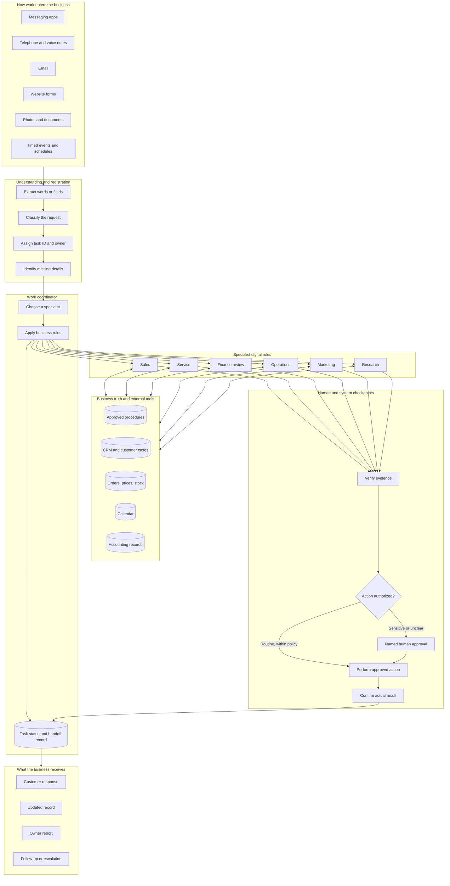
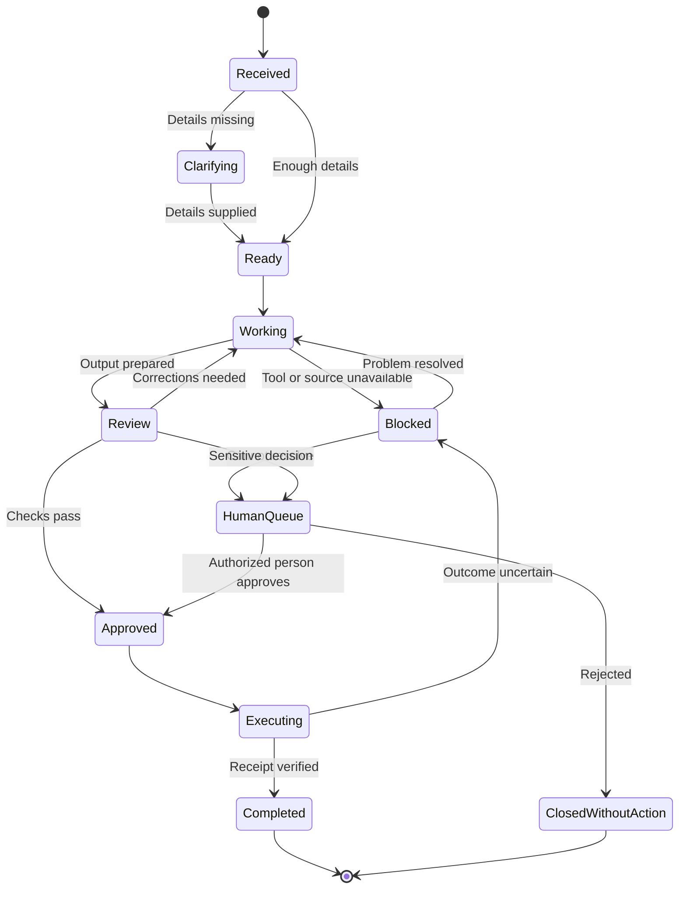

# The complete workforce: how the parts fit together

A working digital workforce is closer to a well-run office than a chat window. There are front desks, shared records, departments, supervisors and rules for handing over unfinished work. A business needs this structure even if its first project involves only two assistants.

## The full reference design

**Do not read this as a shopping list.** It is a map of responsibilities. Several boxes may be handled by the same platform or ordinary spreadsheet at first. The key is that no important responsibility silently disappears.

## The seven layers explained

### 1. Work arrives

A business request can be direct, like a customer asking for a quotation, or indirect, like a supplier uploading an invoice. In both cases, record where it came from. The source matters: a request from an authenticated employee is different from an anonymous contact form. Messages and attached documents are *evidence of a request*, not a license to do whatever they say.

### 2. Intake translates media into work

Voice notes need transcripts; documents may need field extraction; photos need interpretation; text may need language detection. Intake should produce a small standard record: task ID, source, customer or case, requested outcome, evidence, missing information, urgency and proposed department. Unknowns should remain unknown.

### 3. Coordination manages responsibility

The coordinator chooses a specialist based on clear rules and keeps track of who owns the next step. It should not endlessly bounce tasks among agents. Give each handoff a reason, a deadline or review point, and a return route when something goes wrong. A task can be "waiting for customer" or "waiting for approval"—both are valid statuses, not failures.

### 4. Specialists perform distinct jobs

A service specialist interprets a complaint and searches the policy. A sales specialist prepares an offer using approved prices. Finance verifies that an invoice matches a purchase order. A researcher assembles evidence. The role is not just a friendly name; it is defined by its sources, tools, output requirements and boundaries.

### 5. Business systems provide evidence

Product stock comes from inventory, not from a picture. A meeting time comes from a live calendar. An invoice status comes from accounts payable, not from an email. Procedures can live in documents; live values belong in the system that actually owns them. Document date, source and version each matter.

### 6. Authorization decides what can happen

Searching and drafting should not automatically grant sending or payment authority. Add checkpoints where action affects people, money, contractual commitments, privacy or irreversible records. Permissions must be implemented in the connected system or workflow platform; do not rely solely on written instructions.

### 7. Completion produces proof

A successful operation leaves an identifiable result: a sent-message ID, an event in the calendar, a changed record, an approved invoice status or a completed ticket. Without confirmation, the task may remain open. If the result is unknown after a timeout, first inspect the actual system; repeating an operation can duplicate an order or send a second reminder.

## The task's life: from new request to closure

A status diagram is more useful than a vague promise of "memory". A persistent task register stores the current state and makes the next responsible party visible. A chat history alone usually cannot replace this control.

## Central manager or fixed workflow?

**Fixed workflow:** Choose this when there are well-known steps, such as extracting invoice fields, checking duplicates, asking a manager, and filing the result. Predictability is valuable.

**Manager-directed agents:** Choose this when the next specialist genuinely depends on the information received. For example, a supplier issue may require operations, finance or legal review depending on the record.

**Hybrid:** Use a fixed sequence for predictable operations and a limited coordinator for ambiguity. This is often the most practical choice because free-form delegation alone is hard to audit.

## Three realistic configurations

| Organization | Initial roles | Business systems | Most important control |
|---|---|---|---|
| One-person service provider | Intake + scheduling helper | Email, calendar, contact list | Never confirm appointments without a live slot |
| Small retailer | Service + sales + order tracker | Catalog, inventory, order list | Never promise stock or delivery without verifying |
| Multi-department company | Coordinator + departmental specialists + reviewer | CRM, shared documents, finance, tasks | Separate permissions and named human owners |

## Where beginners can simplify

For a first pilot, omit video generation, multi-provider model routing and elaborate departments. Use one input channel, one task register, one or two agents, one approved knowledge source and one review checkpoint. Add the next component only when a measured problem demands it.

[Continue: Task handoffs](../01-foundations/03-coordination-and-handoffs.md) · [See the diagram atlas](../10-diagram-atlas/README.md)
