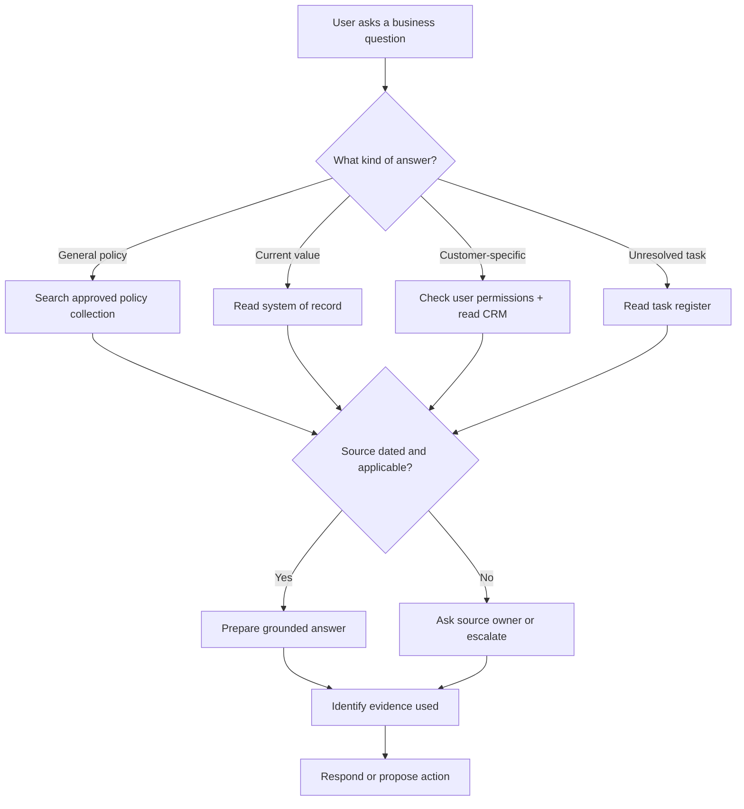

# Company knowledge and memory: a practical workshop

The first question to ask before connecting a model is **where will the correct answer come from?** If a shop's stock count is wrong, a brilliant explanation is still wrong. If a contract has been replaced, a beautiful summary of the old version is still unreliable.

## Five classes of business information

| Information | Example | Best source | Update method | Risk if stale |
|---|---|---|---|---|
| Stable reference | Refund policy | Approved policy library | Controlled document revision | Incorrect promise |
| Frequently changing | Stock and price | Live product or inventory system | Business-system transaction | Overselling or misquotation |
| Customer specific | Order and complaints | CRM or order system | Authorized record update | Data leak or wrong customer |
| Work-in-progress | Who owns an open case | Task register | Handoff and status change | Lost work |
| Restricted | Payroll, medical records, bank details | Restricted system | Authorized personnel only | Severe privacy or financial harm |

**Do not put everything into one searchable folder.** Access controls, data ownership and freshness requirements differ. A marketing guide and a payroll file do not belong in the same broadly accessible knowledge collection.

## The information path

## Building the first approved library

Choose ten common questions the business already receives. For each question, locate the person or system responsible for the answer. Gather the current document, remove unnecessary personal information, and record the approval date. Use meaningful names like `Returns-policy-2026-11-approved` rather than `FINAL_v3_reallyfinal`.

Make a simple knowledge register:

| Document | Owner | Approved? | Effective date | Review due | Who may read it? |
|---|---|---|---|---|---|
| Returns policy | Customer service manager | Yes |  |  | Service staff |
| Delivery charges | Operations manager | Yes |  |  | Sales staff |
| Staff pay guide | HR manager | Yes |  |  | Restricted HR |

Then test how the assistant responds when two documents disagree. A good system should identify the conflict and avoid silently choosing whichever is more convenient.

## Search versus memory

A document library answers, "What is our current procedure?" A task register answers, "What happened to case 128?" A conversation transcript answers, "What did the customer say?" A personal preference record answers, "How does the customer prefer to be contacted?" These are different responsibilities.

Do not use a chat transcript as an indefinite substitute for a customer database. If a customer corrects an address, update the approved system. If the model gives a false address once, do not let that mistaken answer become a permanent fact.

## A complete example: policy revision

On Monday, the return window is 14 days. On Tuesday, management approves a 21-day policy effective next month. On Wednesday, a customer asks about an order purchased yesterday. What matters is the applicable effective date, the order date and any transition rule. A search that simply retrieves "latest return policy" is insufficient.

The assistant should retrieve the policy and its effective date, identify the transaction date, apply the correct transition rule if documented, and escalate if the rule is unclear. The outcome should include the policy source rather than just a statement of confidence.

## A complete example: conflicting stock counts

The product catalog says a machine is available. Inventory shows zero. A draft sales proposal says five. The live inventory record should normally take priority for availability, with exceptions for reserved stock or delayed synchronization. The assistant must not average the quantities or choose the most optimistic. It should flag the discrepancy and ask the record owner.

## Retention and deletion

Before storing conversations or attachments, document why each class of record is retained, who can read it, when it must be reviewed or deleted, and how connected vendors store copies. If a user requests deletion or correction, the business may need to act in several systems, including the CRM, file store and logs, subject to lawful retention requirements.

## A weekly knowledge maintenance routine

- Review top unanswered or disputed questions from the previous week.
- Identify which source documents were wrong, missing or outdated.
- Ask the named owners to approve corrections; do not let the assistant rewrite policy unilaterally.
- Retest affected workflows using the original failing examples.
- Check that restricted information remains inaccessible to unrelated roles.
- Retire old versions or clearly mark them as superseded.

[See the knowledge register template](../11-workbooks/04-knowledge-register.md) · [Business data boundaries](../06-management/03-privacy-and-security.md)
