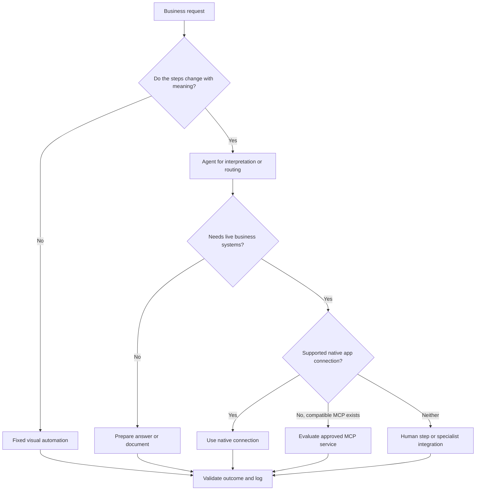

# Automation, an agent and MCP: when to use which

These terms are often sold together, which makes them easy to confuse. Use the practical distinction below when deciding what to build.

**Automation** follows a described series of steps when an event occurs. **An agent** makes limited decisions about the next step using information and instructions. **MCP** is a standard way for an application to discover and use external tools. They can work together, but they do not replace one another.

## Three versions of the same business task

### Version A: fixed automation

When a form arrives, copy the fields to a CRM, notify the sales manager and create a task. This can be a basic Make or Zapier workflow. There is no need to ask a language model which database column to populate if the form fields are already known.

### Version B: agent-assisted process

A customer sends a long email describing an unclear business problem. An agent identifies whether it concerns sales, service or accounts; finds missing details; and produces a proposed response. A conventional workflow can still create the task and preserve the record.

### Version C: agent with MCP tools

The same agent needs to inspect the calendar, product catalog and CRM. Instead of custom-building each interaction, the assistant application can access approved tools exposed by connected services using MCP, where supported. The tool invocation must still respect the user's authority and the workflow's approval requirements.

## When using an agent makes the work worse

A fixed form with three fields does not need elaborate language reasoning. Neither does adding 5% to a confirmed price, scheduling a repeated report, or checking whether a number is larger than another. Choose deterministic steps for arithmetic, known decisions and repeated writes. Reserve a model for language understanding, uncertain classification, summarization and drafting.

## When MCP creates unnecessary complexity

If the workflow platform has a maintained, well-scoped CRM connector, adding a second MCP service may introduce another dependency without improving the result. The key comparison is not which option feels newer; it is which has better access control, support, reliability, auditability and compatibility with your chosen host.

## An owner-friendly comparison

| Dimension | Ordinary automation | Agent step | MCP connection |
|---|---|---|---|
| Decides which path to follow | Defined rules | Can interpret meaning | Does not itself decide; exposes capabilities |
| Can read company records | Through connected app | Only if given retrieval tools | Through authorized tools or resources |
| Can create calendar events | With action permission | Only if a tool is connected | If the server exposes and user may invoke it |
| Handles ambiguous customer language | Limited without a language step | Often useful | Not the language engine |
| Retry behavior | Platform workflow design | Needs workflow support | Not guaranteed by MCP alone |
| Needs monitoring | Yes | Yes | Yes |

## A decision exercise

1. Write one process exactly as an employee performs it today.
2. Underline where judgment or interpretation is genuinely required.
3. Circle the places where information comes from other business applications.
4. Mark actions that change records or affect people outside the business.
5. Build predictable steps as automation; use an agent only for the underlined decisions; expose the circled information using an approved connection; add explicit human control at marked actions.

That exercise often produces a cleaner, cheaper system than starting with a dozen named agents.

[Read the MCP masterclass](01-mcp-business-owner-masterclass.md) · [Read the architecture](05-the-complete-workforce-architecture.md)
