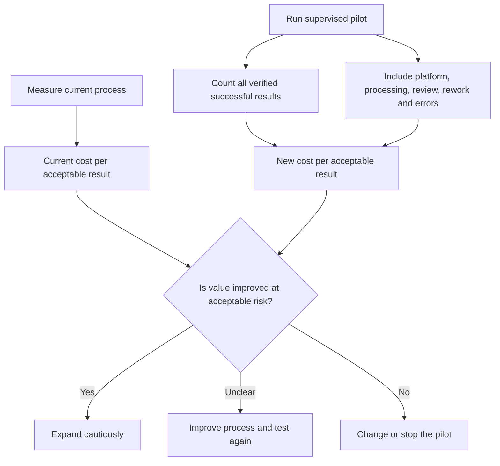

# Does the workforce pay for itself? An owner's calculation

The relevant number is not the model subscription fee or how many messages the assistant produces. It is the **total cost of producing an acceptable business result** compared with how the same work is done today.

## Follow one task all the way through

Suppose a company handles 1,000 routine requests in a month. Before automation, each request uses about seven staff minutes on average. A first pilot successfully handles 600 requests without staff rework, while the others still require human involvement. These are *invented teaching numbers*, not vendor benchmarks.

### Work that could be saved

- Previous handling time: 1,000 × 7 minutes = **7,000 minutes**, or about **116.7 hours**.
- Fully handled by the pilot: 600 × 7 minutes = **4,200 minutes**, or **70 hours** of gross avoided handling.
- If monitoring, corrections and approvals consume **25 hours**, the net staff time freed is **45 hours**.

It would be misleading to claim the system "saves 70 hours" without counting the review time, implementation costs, error corrections and tasks that must still be done.

## The four-part cost ledger

| Category | Example items | What to measure |
|---|---|---|
| Platform | Agent builder, automation, account seats | Monthly fixed and variable fees |
| Processing | Model runs, speech minutes, document pages, media generation | Cost per completed request |
| Operations | Monitoring, data fixes, approval time | Staff hours and incident costs |
| One-off work | Setup, staff training, migration | Amortized period if comparing months |

### Example, with fictional values

| Item | Monthly amount (illustration) |
|---|---:|
| Workflow platform | 100 units |
| Model and document processing | 140 units |
| Messaging and connectors | 60 units |
| Monitoring and review labour | 180 units |
| Total ongoing cost | **480 units** |

If 600 tasks are completed to standard, this gives **0.80 units per successful completed task**. If only 300 were genuinely completed, the cost becomes **1.60 units**. This is why measurement matters more than impressive demonstration videos.

## The correct comparison

Also measure **service quality**. A faster reply that promises the wrong price may be more costly than a slower correct reply. A well-designed process can improve speed and consistency even without reducing staffing. Freed staff time can be redirected to complex customer needs and higher-value work.

## A simple decision table

| Decision | Question |
|---|---|
| Continue | Are verified results good enough for the job? |
| Expand | Are there enough repetitions to justify the setup cost? |
| Simplify | Could an ordinary automation perform the task more cheaply? |
| Pause | Are errors expensive, hard to reverse or difficult to detect? |
| Change provider | Is another platform reliable enough at a lower total cost? |

## Contract questions before committing

Ask what counts as a billable run, how retries are billed, whether voice or document processing is extra, what happens at usage limits, whether the company can export its data, and whether unused credits expire. Check actual pricing pages for your country and plan; price tables in a handbook become outdated quickly.

[Cost workbook](../11-workbooks/07-cost-calculation.md) · [Management cost chapter](../06-management/06-costs-and-value.md)
