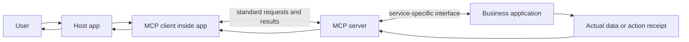

# MCP under the hood, without the technical fog

You do not need to build an MCP server to understand what an MCP-enabled product is doing. But knowing the moving parts helps you ask suppliers better questions and recognize misleading demonstrations.

## The five participants

1. **The person:** An owner, staff member or customer making a request.
2. **The host application:** The product where the request is entered, such as an assistant app or an organizational work platform.
3. **The MCP client:** A part of that application that speaks the protocol to the connected service.
4. **The MCP server:** A program run by a trusted provider that describes available tools and delivers their results.
5. **The business system:** The actual CRM, calendar, file store, database or other service where records live.

The protocol defines a common conversation between the application and service. It does not define the human job description, finance approval policy or business data model.

## What an MCP service exposes

**Tools** are named operations, such as `find_customer`, `list_appointments` or `create_task`. The assistant sees descriptions that help it decide which operation to request. **Resources** expose useful information such as a particular document. **Prompts** offer reusable starting templates. A provider does not necessarily expose all three kinds.

The names of these operations are **illustrative**. Real tool names vary. An owner should ask to see the actual list and determine whether any tool can write, delete, export or send.

## What happens on the first connection?

In a typical remote connection, the user or administrator selects a trusted service and follows an authorization process. In many cases, this uses an account sign-in and consent screen. The system gains access to specific permitted operations and data. A good business setup respects the signed-in user's own access, not merely a shared account whose permissions cover the whole company.

A legitimate connection may have a server address, identity provider, scopes, expiration or reauthorization requirements and administrator settings. These details should be managed through a supported interface. The owner's work is to approve **who can use what** and verify the connection does not exceed the role's responsibility.

## Why tool descriptions matter

Suppose the description says "Find customers and update records." If your business only needs customer lookup, the update capability is unnecessary. The assistant might select the wrong operation, or an outside document might try to influence its choice. The server must validate the authorized user on each request and reject disallowed actions. An application prompt alone cannot provide that enforcement.

## Local versus remote connections

A **local** MCP server runs on the user's computer or a managed device. A **remote** MCP server runs somewhere accessible over a supported network connection. For a no-code owner, remote connections are often easier to operate if provided by a trusted service, while local connections can introduce installation, device permissions and update responsibilities. Neither is automatically safer; the relevant questions are operator trust, authentication, data scope, monitoring and maintenance.

## What changed in the 2026 specification?

The official MCP project published the `2026-07-28` specification, which formalized changes to the core protocol and authorization-related behavior. Examples include a stateless request model, clearer metadata and capability discovery, caching hints, and an extensions framework. These are mostly responsibilities of the providers building MCP clients and servers. Owners still need to focus on tool scope, trust, approval and actual results. A provider claiming to support "MCP" should explain which features and specification version it supports, but not every business requires the latest optional extension.

## Why MCP doesn't eliminate integrations

A server still has to know how to communicate with the underlying business application, and the business account must authorize it. If a bank does not provide an appropriate connector or a trusted intermediary, the fact that MCP exists does not magically open the banking system. Likewise, an MCP connection may only expose search tools even when the underlying app has many write features.

## What does “MCP Apps” mean?

Some MCP-related systems can present richer interactive interfaces, not just plain text. That may allow a task board or dashboard to appear within an assistant experience where supported. It remains a product-specific capability; a business should not assume every MCP host or server can display interactive components. A Markdown handbook can illustrate the idea, but it is not itself a live MCP app.

## A real decision: should you accept a shared connection?

Imagine a vendor offers one service credential that can access all customer records and all staff calendars. Employees would interact with the assistant through their individual accounts, but the underlying connector might see broader company data. Ask whether per-user authorization or narrower service credentials are available. If not, consider a dedicated restricted account, a different connector, a fixed automation, or keeping the task manual.

## Red flags

- A supplier claims MCP makes all business actions safe by default.
- The service lists powerful write tools but cannot describe approval or authorization.
- The business cannot identify who operates the server.
- A remote URL is distributed without a trusted publisher or documentation.
- Every staff user inherits an administrator's unrestricted credential.
- Tool changes become available without review.
- There is no meaningful way to inspect results or revoke access.

**Sources:** [MCP architecture](https://modelcontextprotocol.io/docs/2026-07-28/learn/architecture), [Server features](https://modelcontextprotocol.io/docs/2026-07-28/learn/server-concepts), [Specification release](https://blog.modelcontextprotocol.io/posts/2026-07-28/), [Authorization](https://modelcontextprotocol.io/docs/2026-07-28/tutorials/security/authorization).
