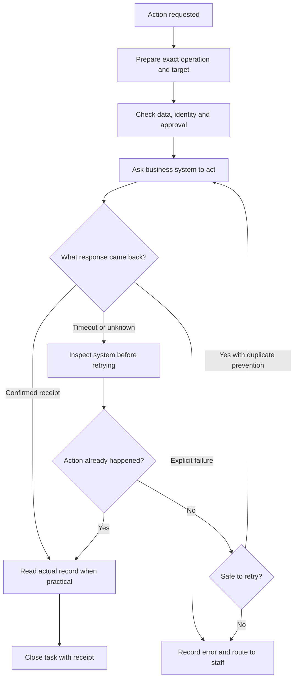

# The hardest part: knowing whether an action really happened

A business can tolerate an imperfect draft because a person can edit it. A mistaken external action is different: a customer may receive the wrong price, an order may be doubled, or an appointment may disappear. The most important design task is to connect **claimed work** to **observed work**.

## Draft, request, result and receipt

Consider an appointment. A model can write "You are booked" even when no calendar event exists. The actual chain is: identify requested service → check availability → obtain required confirmation → create event through the permitted tool → receive an event identifier → verify date and participants → tell the customer. Skipping the receipt breaks the chain.

## Duplicate prevention in ordinary language

If the same email is received twice or a tool times out, a workflow may run again. Without safeguards, it can create another order or send another invoice. Assign each incoming request a stable reference, look for an existing completed action using that reference, and only perform the write when it has not already happened. Many business systems provide their own unique IDs and duplicate checks. The design should use those rather than relying on the assistant to remember.

## Four distinct failures

**Before the call:** The model chooses the wrong record. Fix by validating identity and exact target. **During the call:** The system rejects an action because of permissions. Treat that as a boundary, not a nuisance to work around. **After the call:** The action succeeds but the network reply is lost. Inspect before repeating. **Later:** A staff member changes the record. Report the current state rather than assuming the earlier action is still true.

## Receipts for common work

| Work performed | Useful evidence | Why a written claim is insufficient |
|---|---|---|
| Email sent | Message ID and sent-folder or provider status | Draft may have been mistaken for send |
| Calendar appointment created | Event ID, date/time, attendees | The requested slot might no longer be free |
| CRM opportunity created | Unique record ID and correct account | Duplicate lead may exist |
| Invoice entered | Payables record ID, duplicate check | Extracted fields may be wrong |
| Refund issued | Payment-provider refund reference | Internal note is not a financial transfer |
| Product price changed | Before/after audit record | A draft catalog change might not be published |

## The safe retry checklist

When a tool says "timeout," ask: is this operation read-only? Is it repeatable without adverse impact? Is there a unique request ID? Can the actual external state be inspected? If a second call would create a duplicate transaction, stop and escalate. Controlled retry behavior is often built in the workflow platform, but it still needs to be configured for the particular action.

## One operational rule for owners

Do not measure success by counting model messages or automation runs. Measure **verified final outcomes** and keep tasks open when completion is uncertain.

[See the incident worksheet](../11-workbooks/09-incident-report.md) · [See the task lifecycle](../10-diagram-atlas/03-task-life-and-handoffs.md)
