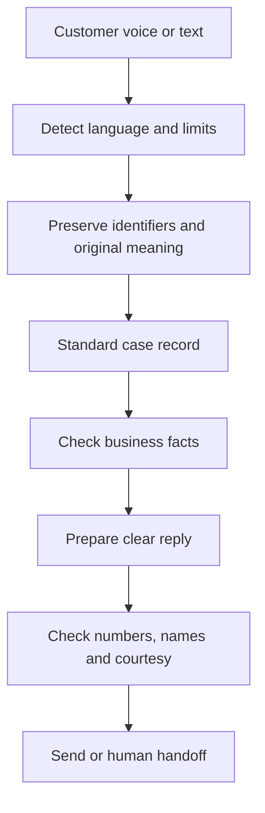

# Language, tone and accessible communication

Many business workflows fail not because the reasoning is difficult but because a response is confusing, too formal, in the wrong language, or missing a critical number. A no-code system should be tested with the people who will actually use it.

## A practical language policy

Determine the business's supported languages, when to offer a human interpreter or staff member, and which terms must stay in their original form. Product codes, legal names, order IDs, currencies and measurements deserve special treatment. Translation should preserve meaning, not "improve" a customer's statement until it says something else.

## Three forms of information

**Customer wording:** Keep the person's meaning as stated, including uncertainty. **Internal record:** Extract standard fields for routing and verification. **Outgoing reply:** Write in the customer's preferred supported language, with simple steps and only verified facts. Store the language choice only when permitted and useful.

## Examples of avoidable confusion

A price of **1,500** may be mistaken for **15,000** when a voice system reads it out. A customer may say "next Friday" in a way that crosses time zones or local holiday schedules. A meeting request may use "morning" without specifying a useful time range. A language model can propose an interpretation but should confirm material details.

A customer who uses short, direct language may not want three paragraphs of courteous boilerplate. A customer with limited digital access may need a clear one-question-at-a-time process. A caller who cannot easily hear synthetic speech may prefer a text confirmation or a person.

## Accessibility checklist

- Can the customer request a human without arguing with the system?
- Is there an alternative to voice-only interaction?
- Are instructions short enough to understand on a small phone screen?
- Are numbers and dates repeated clearly?
- Can the system handle silence, interruptions and corrections?
- Are language limitations disclosed rather than hidden?
- Are messages readable without colors or visual cues alone?

## Test with real communications patterns

Create consented or synthetic samples covering local names, abbreviations, accents, regional spellings, interrupted conversations, polite disagreement and frustrated customers. Record the most common failure patterns and refine the workflow or training material. Keep the model from making up a confident answer when it genuinely did not understand.

[Multimodal workshop](07-multimodal-workshop.md) · [Media test workbook](../11-workbooks/08-voice-photo-document-tests.md)
