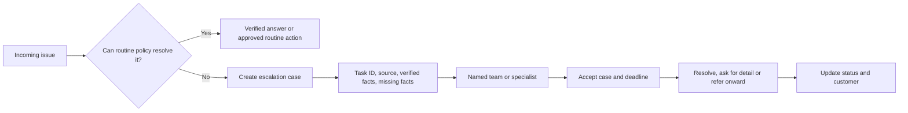

# What should stay with people? Designing useful escalation

A safe system is not one that always refuses. It handles routine work efficiently and passes unusual cases to the right person with enough context to act. Escalation is an ordinary business process, not a sign of failure.

## Four reasons to escalate

**Unclear evidence:** A customer image is ambiguous, documents conflict, or a tool is unavailable. **Beyond permission:** The request involves a discount, publication, refund or sensitive record change. **Beyond competence:** The issue needs a qualified professional, such as clinical judgment, legal interpretation or equipment safety. **Human preference:** The customer or employee asks to speak to a person.

## Escalation should contain a usable summary

A good handoff states what the assistant *knows* and what it does *not know*. It records steps already attempted so staff do not repeat ineffective actions. It does not bury sensitive information inside a general-purpose team chat.

## Examples

A customer asks for a refund outside standard policy: provide the case and relevant order details to a person with refund authority. A caller reports a possible safety emergency: follow the organization's urgent response procedure immediately. A prospect wants a custom contract clause: prepare a list of requested changes and refer to the authorized commercial or legal team. A supplier requests new payment details: independent verification by finance.

## Prevent escalation black holes

Every referred case needs a named owner, expected response period, status, and route back to the original customer or team. A manager should be able to list open cases and see why they are waiting. If nobody accepts a case, it should rise to a backup owner rather than vanishing.

## What a helpful response sounds like

> I can see the confirmed order details, but this request requires a decision outside the standard return policy. I have prepared a case for our service manager and included the order reference and your description. A staff member will review it using the normal process. I have not approved a refund.

Avoid inventing an exact response time unless a service-level commitment is verified.

[Handoff design](../01-foundations/03-coordination-and-handoffs.md) · [Weekly review](../11-workbooks/12-weekly-review.md)
