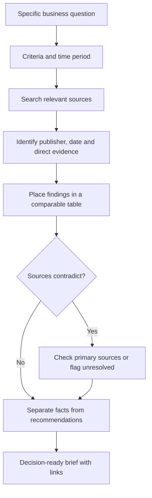

# Research assistants: evidence, citations and decisions

A research assistant can help an owner compare suppliers, investigate competitors, understand a new market or prepare a management briefing. The value is in **traceable evidence and honest uncertainty**, not the number of web pages summarized.

## The research brief

Before starting, identify the question, geography, time period, the kind of decision the owner must make, and what would count as reliable evidence. “Research competitors” is vague; “Compare public warranty and delivery terms for five appliance suppliers serving our city as of this month” is actionable.

## A dependable workflow

## Strong and weak source examples

A supplier's official warranty page is useful for describing **what the supplier currently says**, but it is not independent evidence that every warranty claim is honored. A trade publication can provide context, but an old article may not describe current prices. A forum discussion may reveal customer complaints, but individual reports need caution. A public registry or government source may be best for formal status where available. Match the evidence type to the question.

## Comparison table

| Criterion | Supplier A | Supplier B | Evidence and date |
|---|---|---|---|
| Stated base price |  |  |  |
| Delivery term |  |  |  |
| Warranty |  |  |  |
| Service coverage |  |  |  |
| Verified exclusion |  |  |  |
| Missing information |  |  |  |

Ask the researcher to include a short list of points it **could not verify**. A polished paragraph that hides uncertainty is dangerous for purchasing or strategic decisions.

## Research that uses business tools

A researcher might gather public market information and then query the company's internal sales data. Those are two different trust domains. Public websites are untrusted content; internal CRM records are confidential and permission-controlled. Do not allow a web page's words to instruct the assistant to export company records or send anything to an outside address.

## A useful final brief

A two-page owner briefing can contain the decision question, evidence-based findings, trade-offs, assumptions, unresolved questions, suggested next checks and links to original sources. It should state when research was performed. If public information is missing, say so; do not create a fabricated statistic.

[Research playbook](../05-playbooks/06-research-and-reporting.md) · [MCP trust controls](09-security-and-trust-walkthrough.md)
