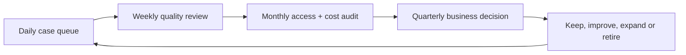

# Running the system after launch: the owner's operating rhythm

A first demonstration is a small part of the work. The real challenge is keeping the system aligned with changing customer expectations, prices, staff responsibilities, products, rules and vendors over months or years.

## Daily checks

Open the task register and inspect work that is overdue, waiting for approval, failing repeatedly or missing evidence. Review customer-facing messages that staff corrected. Ensure there is an available human to handle escalations. Monitor for any unusual spike in actions or costs.

## Weekly review

Review verified completion, quality, financial cost and staff feedback. Check which knowledge sources produced disagreements. Assign named owners to corrections. Choose a small number of workflow improvements and keep the prior version available in case changes reduce reliability.

## Monthly review

Confirm current access permissions and accounts, test the emergency pause, review vendor usage statements, check the list of connected tools, and retest representative normal and difficult cases. Make sure the business can identify who authorized external actions.

## Quarterly review

Revisit whether the process still deserves automation, whether the platform remains appropriate, whether contracts or data terms changed, and whether the business has become dependent on one account or provider. Review applicable privacy and industry obligations with qualified staff where appropriate.

## Avoid the two extreme operating styles

One extreme gives the assistant total freedom and only checks results when a customer complains. The other demands human approval for every harmless read, destroying most productivity gains. The appropriate balance is to automate narrow low-risk steps, preserve verification, and require people where decisions are sensitive or evidence weak.

## A one-page owner dashboard

| Area | Main question | Record to inspect |
|---|---|---|
| Work volume | What arrived this week? | Task register |
| Quality | What was actually completed correctly? | Test cases and verified receipts |
| Customers | What complaints were caused or resolved? | Support cases |
| Staff | Where are people spending review time? | Handoffs and correction log |
| Security | Were access boundaries respected? | Connection and audit logs |
| Spending | What was the cost per acceptable result? | Vendor bills and labor ledger |
| Changes | Which rules, models or sources changed? | Change log and retest results |

A good system makes these questions easy to answer. If the owner cannot inspect the work, the system is not ready for broader autonomy.

[Weekly owner worksheet](../11-workbooks/12-weekly-review.md) · [90-day rollout](../11-workbooks/14-ninety-day-planner.md)
