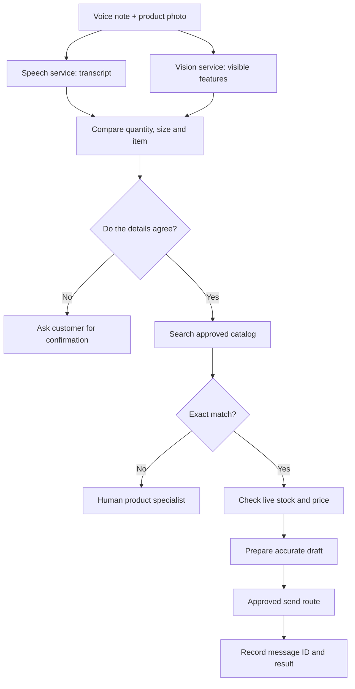

# When different models share one business job

A business does not need one subscription for every task, and it should not send every request to its most expensive model. Different services are good at different kinds of work. The practical challenge is deciding which task belongs where, then making sure the result can be checked.

## First understand what each specialist actually provides

| Piece of the job | What the service is doing | Output you can verify |
|---|---|---|
| Speech recognizer | Turns sound into written words | Transcript with uncertain phrases flagged |
| Visual understanding | Describes what is visible in an image | Items, labels, observations and uncertainty |
| Document extractor | Finds fields in a form, receipt or invoice | Named fields mapped to the original page |
| General language/reasoning model | Explains, drafts, compares or routes | Proposed answer or structured task |
| Search/retrieval service | Finds potentially relevant records | Linked source records |
| Image maker | Creates visual drafts | Graphic for human review |
| Video generator/editor | Produces or edits clips | Draft visual sequence |
| Workflow platform | Connects triggers, actions and approval steps | Run history and actual completed actions |
| MCP or app connection | Makes an external business function available | Verified tool result or record ID |

A video generator is not automatically a surveillance video analyst. Speech generation is not the same as the ability to hold a telephone conversation. A helpful chatbot does not automatically know your company's live stock.

## Example: incoming voice note and picture

A shop customer sends a voice note and a photo of a household part. The transcript might say “three half-inch connectors,” while the photo appears to show a different size. The right response is to ask for confirmation, not choose the model's favorite interpretation.

A low-cost transcription service may work for most customer voices but perform poorly when technical numbers are spoken. A stronger language model cannot recover an incorrect transcript unless the original audio or independent evidence is supplied. Test the *whole chain*.

## Which model deserves the harder work?

Use a simple routing policy:

1. A deterministic rule handles tasks with reliable inputs and obvious outcomes—for example, tagging a document by a known folder.
2. A fast model classifies and summarizes uncomplicated text.
3. A stronger model reviews difficult comparisons, conflicting instructions or longer documents.
4. Specialist media services process audio, photos or video when the selected platform cannot do so sufficiently.
5. The business database confirms facts such as stock, price, schedule, account status and payment.
6. A human decides consequential matters and handles ambiguous cases.

This is a *design recommendation*, not a claim that a named provider always outperforms another. Run representative tests with your own language, documents and tools.

## Common cases where several services create needless complexity

**A weekly internal status report:** Existing spreadsheet formulas and one summarizing model may be enough. Introducing speech, image and video services contributes nothing.

**An incoming invoice:** Specialized extraction plus ordinary validation and human review may outperform an elaborate team that argues over whether a payment should happen.

**A multilingual reception desk:** A model that accurately handles the required languages and is already supported by your channel may be simpler than using separate translation, transcription and drafting services. Test both approaches.

**A complaint involving a photograph:** Vision helps describe observed damage, but order history and policy still determine what can be promised. Another model agreeing that the photo shows damage does not establish a refund entitlement.

## Keeping ownership of the workflow

Document each step by its business purpose rather than the vendor's product name. Write “turn customer audio into verified text” rather than “send everything to vendor X.” Keep input and output expectations consistent. If you later switch models, you should only have to re-test that step and its effects—not rediscover the whole business process.

See [model selection](04-model-selection-decision-trees.md), [model testing](../11-workbooks/03-model-bakeoff.md) and [the operating architecture](05-the-complete-workforce-architecture.md).
