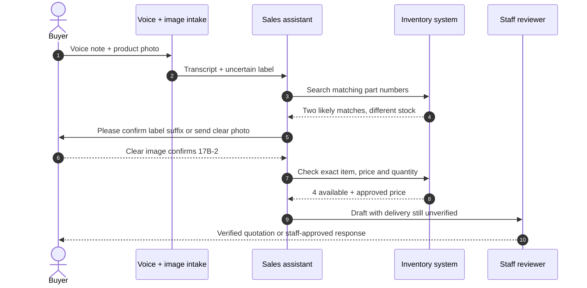

# Case study: a buyer sends a voice note and product photograph

**Business:** A neighborhood retailer selling appliances and spare parts. **Objective:** Provide a truthful reply quickly without promising unavailable stock. **Inputs:** customer voice note, photograph of a product label, live catalog and inventory system.

## What the buyer sends

> Voice note: “Good morning. I need the replacement part in this picture. I think the number is 17B, but I’m not sure. Can you deliver two pieces on Friday? Please tell me the total cost.”

A photograph shows a label ending in `17B-2`, but glare makes the last character uncertain. The company catalog contains two similar parts. The existing inventory system shows one unit of the first part and four of the second.

## What happens in the office

The important decision is **not** whether the assistant sounds confident. It is whether the item has been correctly identified and checked. The assistant must avoid substituting a similar item without the buyer's consent.

## Information to capture

| Field | Source | Rule |
|---|---|---|
| Buyer name | Conversation or authenticated record | Ask if unknown |
| Product code | Photo, confirmed by buyer | Mark uncertainty until confirmed |
| Quantity | Voice transcript | Repeat critical number |
| Unit price | Approved catalog | Do not guess from old quotes |
| Available stock | Live inventory | Check reservations if system supports them |
| Delivery date | Delivery or logistics system | Do not promise without confirmation |
| Total | Verified price, tax and delivery | Display calculation and currency |

## A good draft response

> Thanks for sending the clearer label. We can identify the part as **17B-2**. I have checked the listed unit price and current stock. Before I confirm the delivered total, I need to verify the delivery charge and Friday availability for your address. May I confirm the delivery area?

This response is useful because it clearly distinguishes the verified part and stock from an unverified delivery promise. It does not invent a discount, tax treatment or delivery route.

## What the owner must set up

Create a small approved catalog with identifiers and synonyms. Connect a **read-only** inventory lookup. Decide which employees can issue official quotations and whether a draft must be approved. Define how ambiguous photos are handled. Record a unique inquiry ID so repeated voice notes do not create duplicate orders.

## When the process fails

**Transcription says fifty instead of fifteen:** Confirm the quantity before order creation. **Photo remains unreadable:** Ask for the code in text or a clearer image. **Stock tool is down:** Give no availability promise and leave an open task. **Customer says "I paid" and sends a screenshot:** Verify using the payment provider. **Two customers reserve the same unit:** Use the actual ordering system's reservation controls, not an assistant's memory.

## Pilot scorecard

Track how often the correct product was identified, how many inquiries needed clarification, how often verified pricing was used, average staff review time, duplicate orders, and customer corrections. A high reply rate with wrong part numbers is a failed pilot.

**Adaptations:** Hardware stores, pharmacies for nonclinical product lookup, furniture sellers, electronics repair shops, wholesalers, car-parts businesses.
