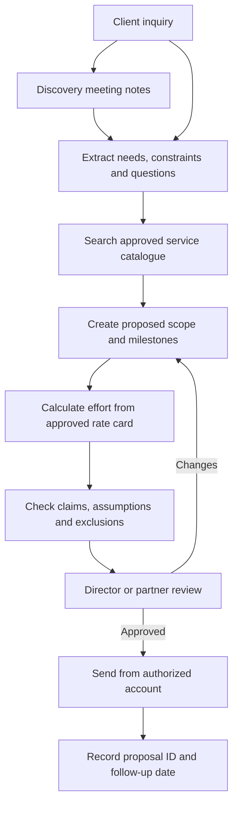

# Case study: a professional services firm prepares a proposal

**Business:** An advisory firm with a small team. **Objective:** Turn an inquiry and meeting notes into a consistent proposal without inventing scope, rates or contractual terms.

## Scenario

A prospective client emails: “We need help improving our supplier reporting. We have three locations, and the finance team sends spreadsheets to headquarters every month.” The director records a 25-minute discovery meeting. The firm has an approved rate card, a proposal template and several past project examples.

## The proposed workflow

## Where the specialist roles help

The Intake role identifies the client's problem and missing facts. The Research role compares the inquiry with approved services, not random internet advice. The Drafting role writes the proposal. The Reviewer verifies that milestones, rates, exclusions and client names are consistent. The director owns commercial terms and final approval.

### The most common drafting failure

A model sees “three locations” and proposes a twelve-week implementation with fixed fees. No evidence supports those assumptions. In a credible proposal, the model can draft **options**, but must label them as alternatives requiring partner approval.

## Proposal structure worth using

1. Client's stated problem, based on source notes.
2. Desired results and how success will be measured.
3. Proposed approach, separated into discovery and delivery phases.
4. Deliverables that the firm can actually produce.
5. Client responsibilities and dependencies.
6. Explicit assumptions, exclusions and open questions.
7. Timeline or range, with basis.
8. Commercial terms from an approved rate card or partner decision.
9. Review and acceptance process.

## Sample extract of a defensible proposal

> **Observed need:** The client currently consolidates monthly reporting spreadsheets from three sites. **Suggested first phase:** Map the reporting fields, approval process and current exceptions. **Not yet confirmed:** Number of reporting templates, quality of the source data, access to existing accounting software, and the expected deployment date. Pricing will follow the agreed scope after these questions are answered.

## The handoff table

| Handoff | Must include | Must not include |
|---|---|---|
| Discovery → Research | Meeting date, source notes, client goals | Guessed budget |
| Research → Drafting | Approved services, comparable examples | Unverified success claims |
| Drafting → Review | Full draft, rate source, assumptions | Hidden commitments |
| Review → Director | Changes made, unresolved questions | Automatic approval |

## Test cases

Insert contradictory meeting notes about delivery timing; a client request outside the firm's service area; a proposal template with stale pricing; and a past case study mentioning confidential client details. Check that the system asks, omits, or escalates rather than fabricating or leaking information.

**Useful measures:** Proposal preparation time, number of corrected claims, proportion approved with minor edits, client acceptance rate and staff confidence in the source record. Conversion rate is a business outcome influenced by many factors, not proof of model accuracy.

**Adaptations:** Consulting, legal administration (with qualified lawyer review), accounting advisory, design studios, engineering services, IT services.
