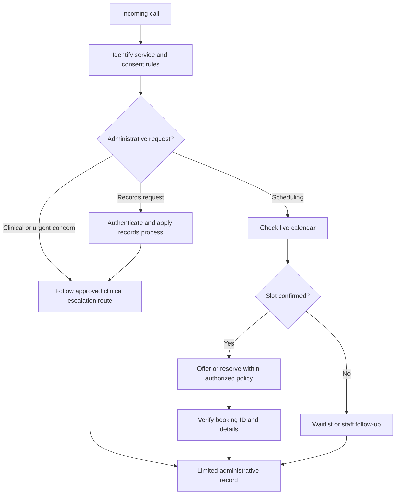

# Case study: a clinic's administrative front desk

**Business:** A clinic handling appointments and routine administrative questions. **Scope:** Appointments, opening hours and document routing only. This is not a diagnostic or treatment system.

## A realistic call

A patient calls and asks whether an appointment is available next Wednesday. They mention a symptom while explaining why they want to visit. The receptionist should provide the clinic's approved scheduling process and transfer clinical concerns to qualified staff rather than making a diagnosis.

## What the system should and should not know

It may use opening hours, clinic address, service categories, booking rules and general preparation instructions approved by staff. It should not infer clinical urgency from a casual phrase or invent medical advice. Where a caller may face immediate danger, follow the clinic's established emergency communication instructions and transfer to trained personnel as quickly as possible.

## Privacy and identity

A phone number alone may not prove identity. A request for a test result, medical record or another person's appointment can require a separate authenticated process. Restrict what appears in transcripts and task summaries; a simple appointment confirmation often needs less information than the caller volunteered.

## An example of a safe answer

> I can help with appointments and general clinic information. I can check the available times for the service you need. For the health question you mentioned, I'll connect you with the appropriate clinical staff; I cannot assess it here.

## Staff handoff should preserve useful context

A transfer should include the call reference, requested administrative action, agreed callback number if permitted, and whether the caller already received scheduling information. Do not force the person to repeat the entire story unnecessarily, but do not include unnecessary sensitive details in a general task board.

## Failure exercises

Ask for a family member's appointment details; present two patients with similar names; describe a possible emergency; remove calendar access; and request a prescription change. The correct response may be refusal, secure identification, or human referral—not successful automation.

## Operating owner

The practice manager owns appointment workflow, staff escalation and availability rules. A qualified clinical lead owns any clinical decision boundary. Privacy and security staff should review integration, access and retention before real patient information is processed.

**Measures:** Correct appointment confirmations, wrong-patient incidents (must be treated seriously), successful human transfers, scheduling correction rate, and caller satisfaction.
