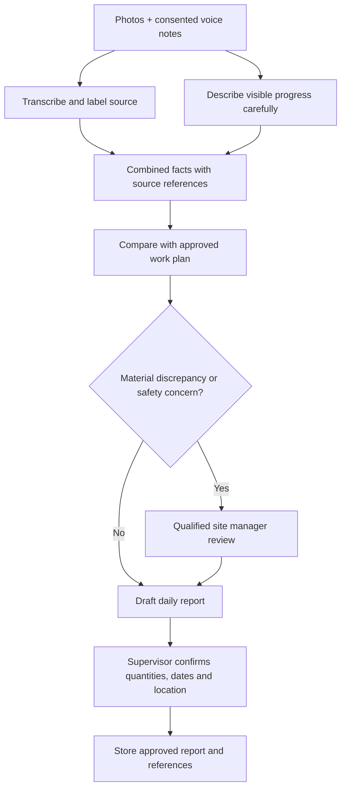

# Case study: a construction supervisor sends site photos and voice notes

**Business:** Building contractor. **Objective:** Prepare a daily progress record from mixed media while keeping safety judgments and contractual decisions with accountable professionals.

## The input pack

At 4 pm, a supervisor uploads seven site photographs and two voice notes. One voice note says, "The western wall is complete to level two, but the reinforcement delivery is still missing." Another says a subcontractor will return tomorrow. The assistant cannot infer what is beyond the camera frame or whether hidden structural work meets standards.

## Daily report workflow

## A report worth reading

A useful report has work completed, materials delivered, workforce present, observed delays, questions requiring decisions, safety observations **as reported by competent staff**, and references to photographs or notes. Every section should state its evidence. "Work complete" should mean that the responsible person confirmed completion, not that a photo looked finished.

### Example of accurate language

> **Reported progress:** The supervisor stated that wall work on the western side reached level two. **Visible evidence:** Photographs 03 and 04 show completed masonry in the photographed area. **Delivery issue:** The supervisor reported that reinforcement supplies had not arrived by the time of recording. **Verification needed:** Confirm actual material delivery status and any effect on tomorrow's schedule with the site manager.

This language keeps observed facts, staff statements and unresolved decisions separate.

## Important boundaries

Do not use a photograph to declare structural compliance, authorize dangerous equipment, replace a safety inspection, calculate legally binding quantities or certify a payment milestone. Those functions require approved professional procedures and original records.

## Common failures to test

One photograph is reused from the previous day; the transcript confuses "four" with "forty" workers; GPS or time metadata is unavailable; a subcontractor disputes the delay explanation; and a site instruction in a PDF asks the assistant to disclose client drawings. The workflow must detect or escalate uncertainty instead of smoothing it over.

**Metrics:** Time to produce a reviewed report, missing source references, incorrect quantities, unresolved action age, and supervisor corrections.
