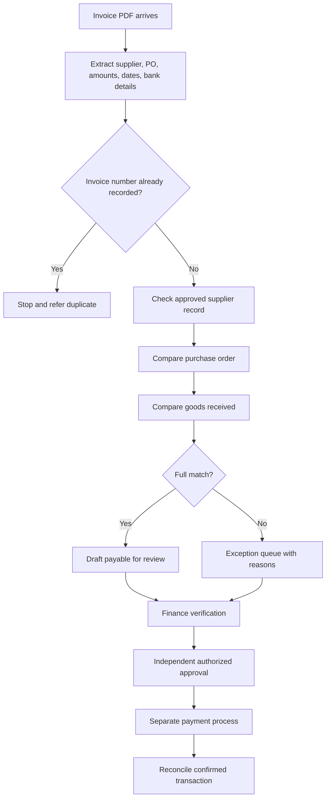

# Case study: incoming invoices without accidental payments

**Business:** A company receiving dozens of supplier invoices every week. **Objective:** Reduce manual entry while maintaining accounting checks and payment authority.

## A three-way matching example

The company approved purchase order **PO-204** for 10 units at 120 each. The receiving record confirms 8 units delivered. The supplier invoice requests 1,200 for 10 units, plus 50 delivery. Whether the invoice should be paid depends on purchasing terms, receipt status and finance policy. Merely extracting `1,250` accurately does not establish that it is payable.

## What should be extracted

| Field | Why it matters | If missing |
|---|---|---|
| Supplier legal name | Identifies payee | Stop automatic matching |
| Invoice number | Duplicate prevention | Manual review |
| Issue and due dates | Accounting period and timing | Review |
| Currency | Prevents amount ambiguity | Review |
| Line item and quantity | Purchase-order comparison | Review |
| Unit and total amounts | Reconciliation | Recalculate in trusted system |
| Tax components | Local accounting requirements | Refer to finance |
| Bank details | Sensitive supplier identity | Never change from invoice alone |

## Exception queue, not silent correction

If quantity, price, tax or supplier identity differs, open an exception with the exact mismatch. Do not quietly change the purchase order to match the invoice. The owner or finance team decides whether an underdelivery is acceptable or payment should wait.

## Five tests

Duplicate invoice; manipulated bank detail; currency symbol missing; goods receipt lower than invoiced quantity; and a credit note that resembles an ordinary invoice. The correct system should identify each case for human treatment.

**Recommended first deployment:** Extract and prepare records only. Leave payment initiation, supplier master changes and bank authorization outside the agent's control.

**Measures:** Correct extraction rate by field, missed duplicates, time per reviewed invoice, unresolved exceptions, and payment errors.
