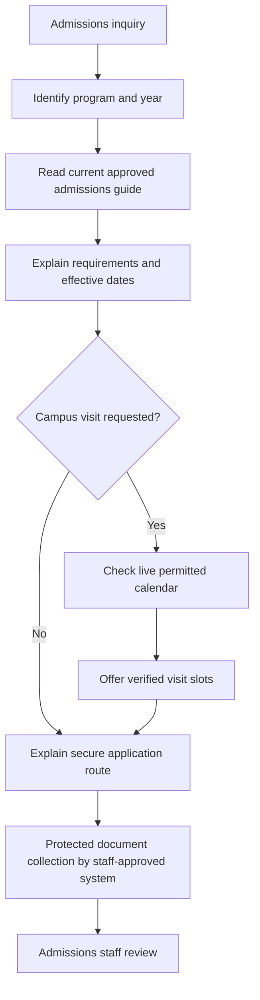

# Case study: a school handles admissions questions

**Business:** School or training center. **Scope:** General admissions information, applications and appointment scheduling. Decisions about admission, scholarships, accommodation and student welfare remain under designated human governance.

## The family inquiry

A parent asks by WhatsApp, "What documents do I need for admission, when are applications due, and can we visit on Saturday?" They then send a photograph of a birth certificate.

A well-designed process answers from the current admissions guide, checks a visit calendar, and routes personal documents to the school's protected admissions process. The public chat system should not ask the parent to broadcast sensitive documents into an unrestricted channel.

## Hidden operational challenges

Admission rules may vary by age, program or academic year. A notice for last year's intake must not override the current guide. Applicants may share documents for children or vulnerable people, requiring careful access control, retention and identity checks. An automatically generated message should not be interpreted as an admission decision.

## Safe response example

> For the current intake, the admissions guide lists the required documents and the application deadline. I can share the official application route and check available visit appointments. Please upload personal documents only through the school's approved secure process; I cannot determine admission eligibility in this chat.

## Test before launch

Ask for last year's deadline; request another student's file; send a photo containing an unrelated child's details; ask whether a scholarship is guaranteed; and try to reserve a visit when the calendar service is down. Correct behavior is to cite the current guide, protect personal information and escalate uncertainty.

**Adaptations:** Colleges, vocational institutes, professional training companies and other educational administration.
